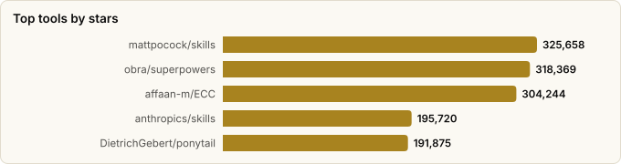
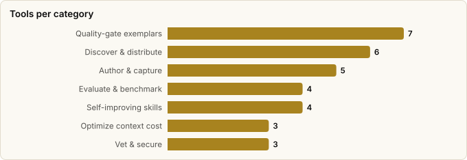

# Agent Skills — How to Write, Measure, Slim Down and Secure Them

> Derived from **kaiser-data**'s 2,896 starred repos (snapshot `2026-11-16T14:38:50.632Z`), cross-referenced with the repo-similarity graph (2,896 nodes / 9,609 edges).
>
> Generated 2026-11-18 by `scripts/reports/agent_skills.py` (regenerate any time — no API cost).

## Executive summary

- **32 repos about making skills better** (2,335,961★), sorted by the stage of a skill's life they help with. Skill *packs* (collections of content) are left to the Claude Code Superpowers report; this one is about the craft.
- **Most skills are never measured.** Only a few repos here test a skill against a baseline: `microsoft/waza` (graded trials, token budgets, eval coverage) and `stevesolun/ctx` (cheapest setup that stays reliable on your own repo). Start there before tuning wording.
- **Context cost is the quiet tax.** Every installed skill's description sits in the context on every turn; the body loads when triggered. Cut both: short descriptions, bodies split into files loaded on demand (`book-to-skill`), unused skills removed (`token-optimizer`), and a token budget enforced in review (`waza tokens compare`).
- **The best skills end with a check that can fail.** `hallmark` lints in a real browser and asks a fresh-context reviewer; `fable-mode` and `addyosmani/agent-skills` put a gate on every stage. Copy that shape.
- **Install with suspicion.** NVIDIA's `SkillSpector` dataset found 26.1% of 31,132 public skills vulnerable and 5.2% likely malicious (its own figures). Scan before installing anything from a large catalog.
- **Self-improving skills are promising but thin.** `OpenSpace`, `UpSkill` and `Memento-Skills` all evolve skills from runs, but the first two have stalled and none publishes an independent evaluation. `ECC` is the maintained option today.
- **New stars in this report:** `mattpocock/skills`, `Nutlope/hallmark`, `HKUDS/OpenSpace`.

## The life of a skill

| Stage | The question it answers | Reach for |
|---|---|---|
| **Author & capture** | How do I write (or record) it in the right shape? | `skills`, `superpowers`, `skills` |
| **Evaluate & benchmark** | Does it help, compared with no skill? | `waza`, `skill`, `fable-mode` |
| **Optimize context cost** | What does it cost in tokens, and can that be cut? | `ponytail`, `caveman`, `token-optimizer` |
| **Quality-gate exemplars** | How does the skill check its own output? | `agent-skills`, `taste-skill`, `impeccable` |
| **Self-improving skills** | Can it get better from its own runs? | `ECC`, `OpenViking`, `Memento-Skills` |
| **Discover & distribute** | Is there already one, and how do I ship mine? | `awesome-claude-skills`, `agentic-awesome-skills`, `claude-plugins-official` |
| **Vet & secure** | Is it safe to install? | `SkillSpector`, `AI-Infra-Guard`, `agent-skills` |

## Master comparison

| Repo | Stage | ★ | Health | Activity | Lifecycle | What it does |
|---|---|---|---|---|---|---|
| [mattpocock/skills](https://github.com/mattpocock/skills) | Author & capture | 325,658 (▲6,435) | 77 | very active | Hot | Small, composable engineering skills that keep you in control instead of owning the whole process. A model of how short a good skill can be. |
| [obra/superpowers](https://github.com/obra/superpowers) | Author & capture | 318,369 (▲3,481) | 63 | active | Mature | Skills framework plus a method for writing skills test-first: watch the agent fail without the skill, then write only what fixes it. |
| [anthropics/skills](https://github.com/anthropics/skills) | Author & capture | 195,720 (▲5,378) | 50 | active | Mature | The reference for the format: `name` + `description` frontmatter, a template skill, and official examples. Start every skill here. |
| [virgiliojr94/book-to-skill](https://github.com/virgiliojr94/book-to-skill) | Author & capture | 38,078 (▲626) | 91 | very active | Hot | Turns a book, a folder or a set of sources into one skill with per-chapter files loaded on demand. Claims 24–51× fewer tokens than pasting the book. |
| [microsoft/skill-recorder](https://github.com/microsoft/skill-recorder) | Author & capture | 5,831 (▲107) | 65 | very active | Hot | Record yourself doing a task once; it reconstructs the intent and ordered steps and turns them into a reusable skill. |
| [microsoft/waza](https://github.com/microsoft/waza) | Evaluate & benchmark | 1,511 (▲5) | 79 | very active | Hot | The most complete skill test bench here: graded trials, model comparisons, eval coverage against SKILL.md, token counts and budget diffs against main. |
| [pinchbench/skill](https://github.com/pinchbench/skill) | Evaluate & benchmark | 1,385 (▲5) | 43 | slowing | Declining | Real-task benchmark for models acting as OpenClaw agents. Useful as a task pool when you build your own skill evals. |
| [mrtooher/fable-mode](https://github.com/mrtooher/fable-mode) | Evaluate & benchmark | 891 (▲3) | 63 | very active | Rising | A planning-and-verification skill benchmarked three times, with a README that says what the skill does not do. A good template for honest skill claims. |
| [stevesolun/ctx](https://github.com/stevesolun/ctx) | Evaluate & benchmark | 593 (▲4) | 61 | active | Rising | Tests candidate agent setups (instructions, skills, tools) against real tasks in your repo and applies the cheapest one that stays reliable. |
| [DietrichGebert/ponytail](https://github.com/DietrichGebert/ponytail) | Optimize context cost | 191,875 (▲4,547) | 96 | very active | Hot | A 'write less code' skill with an A/B benchmark: −45% tokens and −53% code on 39 tasks, while more risky logic shipped with a test. |
| [JuliusBrussee/caveman](https://github.com/JuliusBrussee/caveman) | Optimize context cost | 120,649 (▲2,118) | 79 | very active | Hot | A skill that makes the agent answer tersely. Claims ~65% fewer output tokens; you trade some readability. |
| [alexgreensh/token-optimizer](https://github.com/alexgreensh/token-optimizer) | Optimize context cost | 2,995 (▲55) | 80 | very active | Rising | Audits where context goes, including unused skills, bloated configs and stale memory, then trims it with hooks. |
| [addyosmani/agent-skills](https://github.com/addyosmani/agent-skills) | Quality-gate exemplars | 118,171 (▲3,800) | 77 | very active | Hot | Engineering skills mapped to a lifecycle (spec → plan → build → test → review → ship), each with its own quality gate. |
| [Leonxlnx/taste-skill](https://github.com/Leonxlnx/taste-skill) | Quality-gate exemplars | 116,584 (▲4,255) | 78 | very active | Hot | Design skills that ask for reference images and end with a browser check instead of trusting the first render. |
| [pbakaus/impeccable](https://github.com/pbakaus/impeccable) | Quality-gate exemplars | 111,127 (▲4,543) | 79 | very active | Mature | Design vocabulary for coding agents: steer with named moves, then review with a critique pass. |
| [cloudflare/security-audit-skill](https://github.com/cloudflare/security-audit-skill) | Quality-gate exemplars | 73,592 (▲6,049) | 35 | slowing | Declining | Multi-phase security audit skill whose findings are verified independently and written in a machine-readable format. |
| [ayghri/i-have-adhd](https://github.com/ayghri/i-have-adhd) | Quality-gate exemplars | 61,360 (▲764) | 58 | very active | Hot | One narrow output rule (answer first) packaged as a skill. Shows how small a skill that changes behaviour can be. |
| [Nutlope/hallmark](https://github.com/Nutlope/hallmark) | Quality-gate exemplars | 55,850 (▲4,399) | 57 | very active | Hot | Design skill that lints its own result in a real browser against known AI-slop patterns, then hands it to a fresh-context reviewer. Gates in tiers. |
| [hardikpandya/stop-slop](https://github.com/hardikpandya/stop-slop) | Quality-gate exemplars | 18,983 (▲217) | 11 | stale | Declining | A single skill file that strips AI tells from prose. Narrow scope, easy to test. |
| [affaan-m/ECC](https://github.com/affaan-m/ECC) | Self-improving skills | 304,244 (▲4,264) | 79 | very active | Hot | Harness performance system that turns repeated wins into skills and 'instincts'; plan → test → review → remember → improve. |
| [volcengine/OpenViking](https://github.com/volcengine/OpenViking) | Self-improving skills | 42,304 (▲448) | 92 | very active | Hot | Context database that stores skills next to memory and knowledge as browsable files with generated summaries. |
| [Memento-Teams/Memento-Skills](https://github.com/Memento-Teams/Memento-Skills) | Self-improving skills | 1,588 | 28 | slowing | Declining | A skill-centred agent runtime that writes and refines its own skills through reflection and replanning. |
| [HKUDS/UpSkill](https://github.com/HKUDS/UpSkill) | Self-improving skills | 102 (▲1) | 26 | slowing | Declining | Captures agent failures, distils them into skills validated in a loop, and injects them so a cheaper model can do the job. |
| [ComposioHQ/awesome-claude-skills](https://github.com/ComposioHQ/awesome-claude-skills) | Discover & distribute | 79,630 (▲517) | 26 | active | Declining | The most-starred curated list of Claude skills and tools. |
| [sickn33/agentic-awesome-skills](https://github.com/sickn33/agentic-awesome-skills) | Discover & distribute | 49,792 (▲394) | 80 | very active | Hot | 2,884+ SKILL.md playbooks plus AAS Core, which lets the agent search the catalog locally and preview a plan. It does not rank skills. |
| [anthropics/claude-plugins-official](https://github.com/anthropics/claude-plugins-official) | Discover & distribute | 47,429 (▲872) | 62 | very active | Hot | Anthropic's plugin directory; plugins are how skills ship with hooks, commands and updates. Third-party entries still need vetting. |
| [openclaw/clawhub](https://github.com/openclaw/clawhub) | Discover & distribute | 9,554 (▲4) | 80 | very active | Hot | The skill and plugin registry for OpenClaw. |
| [arcadeai-labs/smithery-cli](https://github.com/arcadeai-labs/smithery-cli) | Discover & distribute | 846 (▼1) | 37 | slowing | Declining | CLI to search, install and develop MCP servers and skills from the Smithery registry. |
| [nextlevelbuilder/skillx](https://github.com/nextlevelbuilder/skillx) | Discover & distribute | 197 (▲2) | 74 | very active | Hot | Skill marketplace with semantic search, a leaderboard, and a CLI that reports each skill run's outcome back. |
| [NVIDIA/SkillSpector](https://github.com/NVIDIA/SkillSpector) | Vet & secure | 26,361 (▲1,350) | 83 | very active | Hot | Scans a skill before install for prompt injection, exfiltration and supply-chain risks. Its dataset: 26.1% of 31,132 skills vulnerable, 5.2% likely malicious. |
| [Tencent/AI-Infra-Guard](https://github.com/Tencent/AI-Infra-Guard) | Vet & secure | 7,523 (▲79) | 99 | very active | Hot | Red-teaming platform with a dedicated skills scan next to agent, MCP and infrastructure scans. |
| [tech-leads-club/agent-skills](https://github.com/tech-leads-club/agent-skills) | Vet & secure | 7,169 (▲19) | 74 | very active | Hot | A registry that only publishes verified, tested skills, citing >13% of marketplace skills with critical vulnerabilities. |

## By stage

### Author & capture

_A skill is a `SKILL.md` with two frontmatter fields and instructions. The description decides when it fires; the body is what the agent reads after. Write the smallest skill that changes the behaviour you saw fail._

- **[mattpocock/skills](https://github.com/mattpocock/skills)** · 325,658★ · Shell · Hot · health 77 · last push 3d ago  
  Small, composable engineering skills that keep you in control instead of owning the whole process. A model of how short a good skill can be.  
  topics: —
- **[obra/superpowers](https://github.com/obra/superpowers)** · 318,369★ · Shell · Mature · health 63 · last push 13d ago  
  Skills framework plus a method for writing skills test-first: watch the agent fail without the skill, then write only what fixes it.  
  topics: ai, brainstorming, coding, obra, sdlc, skills
- **[anthropics/skills](https://github.com/anthropics/skills)** · 195,720★ · Python · Mature · health 50 · last push 0d ago  
  The reference for the format: `name` + `description` frontmatter, a template skill, and official examples. Start every skill here.  
  topics: agent-skills
- **[virgiliojr94/book-to-skill](https://github.com/virgiliojr94/book-to-skill)** · 38,078★ · Python · Hot · health 91 · last push 8d ago  
  Turns a book, a folder or a set of sources into one skill with per-chapter files loaded on demand. Claims 24–51× fewer tokens than pasting the book.  
  topics: agent-skills, ai-agents, context-engineering, document-processing, edtech, knowledge-base
- **[microsoft/skill-recorder](https://github.com/microsoft/skill-recorder)** · 5,831★ · TypeScript · Hot · health 65 · last push 4d ago  
  Record yourself doing a task once; it reconstructs the intent and ordered steps and turns them into a reusable skill.  
  topics: agent-skills, ai-agents, automation, copilot, copilot-cli, copilot-cowork

### Evaluate & benchmark

_Run the same tasks with and without the skill, grade the results, and keep the runs. Without this, every later optimization is a guess._

- **[microsoft/waza](https://github.com/microsoft/waza)** · 1,511★ · Go · Hot · health 79 · last push 0d ago  
  The most complete skill test bench here: graded trials, model comparisons, eval coverage against SKILL.md, token counts and budget diffs against main.  
  topics: —
- **[pinchbench/skill](https://github.com/pinchbench/skill)** · 1,385★ · Python · Declining · health 43 · last push 4mo ago  
  Real-task benchmark for models acting as OpenClaw agents. Useful as a task pool when you build your own skill evals.  
  topics: —
- **[mrtooher/fable-mode](https://github.com/mrtooher/fable-mode)** · 891★ · Python · Rising · health 63 · last push 1d ago  
  A planning-and-verification skill benchmarked three times, with a README that says what the skill does not do. A good template for honest skill claims.  
  topics: —
- **[stevesolun/ctx](https://github.com/stevesolun/ctx)** · 593★ · Python · Rising · health 61 · last push 1mo ago  
  Tests candidate agent setups (instructions, skills, tools) against real tasks in your repo and applies the cheapest one that stays reliable.  
  topics: agents, ai-agents, anthropic, automation, claude, claude-code

### Optimize context cost

_Descriptions are always loaded; bodies load when triggered; extra files load only when read. Push detail down that ladder._

- **[DietrichGebert/ponytail](https://github.com/DietrichGebert/ponytail)** · 191,875★ · JavaScript · Hot · health 96 · last push 18d ago  
  A 'write less code' skill with an A/B benchmark: −45% tokens and −53% code on 39 tasks, while more risky logic shipped with a test.  
  topics: agent-skills, ai-agents, claude, claude-code, claude-code-plugin, cursor-rules
- **[JuliusBrussee/caveman](https://github.com/JuliusBrussee/caveman)** · 120,649★ · Go · Hot · health 79 · last push 0d ago  
  A skill that makes the agent answer tersely. Claims ~65% fewer output tokens; you trade some readability.  
  topics: ai, anthropic, caveman, claude, claude-code, llm
- **[alexgreensh/token-optimizer](https://github.com/alexgreensh/token-optimizer)** · 2,995★ · Python · Rising · health 80 · last push 4d ago  
  Audits where context goes, including unused skills, bloated configs and stale memory, then trims it with hooks.  
  topics: claude-code, token-optimization, context-window, token-usage, context-engineering, token-optimizer

### Quality-gate exemplars

_Skills worth copying for their *shape*: they finish with a check that can fail, and they ask a reviewer without the author's context._

- **[addyosmani/agent-skills](https://github.com/addyosmani/agent-skills)** · 118,171★ · JavaScript · Hot · health 77 · last push 2d ago  
  Engineering skills mapped to a lifecycle (spec → plan → build → test → review → ship), each with its own quality gate.  
  topics: agent-skills, antigravity, claude-code, cursor, skills, codex
- **[Leonxlnx/taste-skill](https://github.com/Leonxlnx/taste-skill)** · 116,584★ · JavaScript · Hot · health 78 · last push 8d ago  
  Design skills that ask for reference images and end with a browser check instead of trusting the first render.  
  topics: claude-code, codex, frontend, agent-skills, ai-agents, anti-slop
- **[pbakaus/impeccable](https://github.com/pbakaus/impeccable)** · 111,127★ · Rust · Mature · health 79 · last push 0d ago  
  Design vocabulary for coding agents: steer with named moves, then review with a critique pass.  
  topics: agent-skills, ai, anti-slop, design, slop
- **[cloudflare/security-audit-skill](https://github.com/cloudflare/security-audit-skill)** · 73,592★ · JavaScript · Declining · health 35 · last push 2mo ago  
  Multi-phase security audit skill whose findings are verified independently and written in a machine-readable format.  
  topics: —
- **[ayghri/i-have-adhd](https://github.com/ayghri/i-have-adhd)** · 61,360★ · Python · Hot · health 58 · last push 28d ago  
  One narrow output rule (answer first) packaged as a skill. Shows how small a skill that changes behaviour can be.  
  topics: adhd, claude-, claude-code-plugin, claude-skills, developer-tools, productivity
- **[Nutlope/hallmark](https://github.com/Nutlope/hallmark)** · 55,850★ · CSS · Hot · health 57 · last push 5d ago  
  Design skill that lints its own result in a real browser against known AI-slop patterns, then hands it to a fresh-context reviewer. Gates in tiers.  
  topics: —
- **[hardikpandya/stop-slop](https://github.com/hardikpandya/stop-slop)** · 18,983★ · — · Declining · health 11 · last push 8mo ago  
  A single skill file that strips AI tells from prose. Narrow scope, easy to test.  
  topics: —

### Self-improving skills

_Systems that write or rewrite skills from experience. Treat every automatic edit as a pull request that needs a test._

- **[affaan-m/ECC](https://github.com/affaan-m/ECC)** · 304,244★ · JavaScript · Hot · health 79 · last push 0d ago  
  Harness performance system that turns repeated wins into skills and 'instincts'; plan → test → review → remember → improve.  
  topics: ai-agents, anthropic, claude, claude-code, developer-tools, llm
- **[volcengine/OpenViking](https://github.com/volcengine/OpenViking)** · 42,304★ · Python · Hot · health 92 · last push 0d ago  
  Context database that stores skills next to memory and knowledge as browsable files with generated summaries.  
  topics: context-database, agentic-rag, agent-memory, self-evolving, agent-plugins, dsh-plugin
- **[Memento-Teams/Memento-Skills](https://github.com/Memento-Teams/Memento-Skills)** · 1,588★ · Python · Declining · health 28 · last push 3mo ago  
  A skill-centred agent runtime that writes and refines its own skills through reflection and replanning.  
  topics: —
- **[HKUDS/UpSkill](https://github.com/HKUDS/UpSkill)** · 102★ · Shell · Declining · health 26 · last push 3mo ago  
  Captures agent failures, distils them into skills validated in a loop, and injects them so a cheaper model can do the job.  
  topics: —

### Discover & distribute

_Where skills are found and how they ship. Catalogs are large and unranked; plugins add updates and hooks._

- **[ComposioHQ/awesome-claude-skills](https://github.com/ComposioHQ/awesome-claude-skills)** · 79,630★ · Python · Declining · health 26 · last push 1mo ago  
  The most-starred curated list of Claude skills and tools.  
  topics: claude, claude-code, agent-skills, ai-agents, antigravity, automation
- **[sickn33/agentic-awesome-skills](https://github.com/sickn33/agentic-awesome-skills)** · 49,792★ · Python · Hot · health 80 · last push 1d ago  
  2,884+ SKILL.md playbooks plus AAS Core, which lets the agent search the catalog locally and preview a plan. It does not rank skills.  
  topics: agentic-skills, ai-agents, antigravity, claude-code, mcp, ai-workflows
- **[anthropics/claude-plugins-official](https://github.com/anthropics/claude-plugins-official)** · 47,429★ · Python · Hot · health 62 · last push 0d ago  
  Anthropic's plugin directory; plugins are how skills ship with hooks, commands and updates. Third-party entries still need vetting.  
  topics: claude-code, mcp, skills
- **[openclaw/clawhub](https://github.com/openclaw/clawhub)** · 9,554★ · TypeScript · Hot · health 80 · last push 0d ago  
  The skill and plugin registry for OpenClaw.  
  topics: directory, skill
- **[arcadeai-labs/smithery-cli](https://github.com/arcadeai-labs/smithery-cli)** · 846★ · TypeScript · Declining · health 37 · last push 5mo ago  
  CLI to search, install and develop MCP servers and skills from the Smithery registry.  
  topics: —
- **[nextlevelbuilder/skillx](https://github.com/nextlevelbuilder/skillx)** · 197★ · TypeScript · Hot · health 74 · last push 8d ago  
  Skill marketplace with semantic search, a leaderboard, and a CLI that reports each skill run's outcome back.  
  topics: —

### Vet & secure

_A skill runs with your agent's permissions. Scan it like a dependency._

- **[NVIDIA/SkillSpector](https://github.com/NVIDIA/SkillSpector)** · 26,361★ · Python · Hot · health 83 · last push 0d ago  
  Scans a skill before install for prompt injection, exfiltration and supply-chain risks. Its dataset: 26.1% of 31,132 skills vulnerable, 5.2% likely malicious.  
  topics: agent-security, agent-skills, agentic-ai, ai-security, claude-code, mcp
- **[Tencent/AI-Infra-Guard](https://github.com/Tencent/AI-Infra-Guard)** · 7,523★ · Python · Hot · health 99 · last push 1d ago  
  Red-teaming platform with a dedicated skills scan next to agent, MCP and infrastructure scans.  
  topics: agent, llm, scanner, security, vulnerability, agent-security
- **[tech-leads-club/agent-skills](https://github.com/tech-leads-club/agent-skills)** · 7,169★ · TypeScript · Hot · health 74 · last push 5d ago  
  A registry that only publishes verified, tested skills, citing >13% of marketplace skills with critical vulnerabilities.  
  topics: agent, skills, ai, antigravity, claude-code, copilot

## Task rankings

| Task | 🥇 First pick | 🥈 Second | 🥉 Third | Evidence / note |
|---|---|---|---|---|
| **Prove a skill actually helps (with vs. without)** | `microsoft/waza` — graded trials, `compare` across runs/models | `stevesolun/ctx` — real tasks in your repo; reliability floor, then cost | `pinchbench/skill` — borrow its real-world tasks for your eval set | waza and ctx both decide from runs, not from an LLM's opinion; ctx explicitly lets an LLM explain but never pick. |
| **Make a skill trigger when it should** | `microsoft/waza` — `spec verify` + `coverage` check evals against SKILL.md | `anthropics/skills` — the description is the trigger — follow the template | `mattpocock/skills` — short, single-purpose skills are easier to route | Only waza tests triggering directly; the other two are patterns to copy. |
| **Cut what a skill costs in context** | `microsoft/waza` — `tokens compare main --threshold` fails a PR that bloats a skill | `alexgreensh/token-optimizer` — finds unused skills and bloated configs | `virgiliojr94/book-to-skill` — per-chapter files loaded on demand; 24–51× claim | Load-on-demand files (progressive disclosure) are the main lever; the % figures are the projects' own. |
| **Make the output of a skill trustworthy** | `Nutlope/hallmark` — browser lint + fresh-context reviewer, tiered gates | `addyosmani/agent-skills` — a gate per lifecycle phase | `mrtooher/fable-mode` — checks that can actually fail + cold double-check | Common pattern: the skill ends with a check that can fail, run by something other than the author's context. |
| **Turn experience into new skills** | `microsoft/skill-recorder` — record the task once, get intent + steps | `virgiliojr94/book-to-skill` — from documents | `HKUDS/UpSkill` — from failures — but declining, verify first | Recorder and book-to-skill are active; UpSkill's loop is the right idea with thin maintenance. |
| **Let skills improve between runs** | `affaan-m/ECC` — best-maintained; wins become skills/instincts | `HKUDS/OpenSpace` — most complete idea (retrieve, evaluate, evolve) — stale | `Memento-Teams/Memento-Skills` — reflection-driven, now a desktop app | None of these publishes an independent evaluation of the evolved skills; keep a human review on every change. |
| **Check a skill before installing it** | `NVIDIA/SkillSpector` — purpose-built, part of NVIDIA's signing pipeline | `Tencent/AI-Infra-Guard` — skills scan inside a full red-team platform | `tech-leads-club/agent-skills` — install only from a vetted registry | SkillSpector's 26.1% / 5.2% figures come from its own research dataset. |
| **Find an existing skill instead of writing one** | `sickn33/agentic-awesome-skills` — local catalog search via AAS Core | `anthropics/claude-plugins-official` — official directory, plugin updates | `openclaw/clawhub` — if you run OpenClaw | Large catalogs do not rank quality — scan whatever you pick (row above). |

## Spotlight — a skill optimization loop

Put together from the repos above. Each step names the tool that makes it concrete.

1. **Baseline.** Write 5–10 real tasks the skill is meant to help with, plus 2–3 it should *not* fire on. Run them without the skill and keep the outputs (`waza run`, or `ctx` on your repo).
2. **Write the smallest fix.** Add only what changes the failures you saw (`obra/superpowers`' test-first method; `mattpocock/skills` for size).
3. **Tune the description.** It is the only part always in context and the only thing that triggers the skill: say what it does *and* when to use it, with the words a user would type. Check firing on both task sets (`waza spec verify`, `coverage`).
4. **Push detail down.** Move reference material into separate files the body links to, so it loads only when needed (`book-to-skill`). Set a token budget and fail review when a change exceeds it (`waza tokens compare main --threshold 10`).
5. **End with a gate.** The last step should be a check that can fail — a lint, a test, a browser render, a fresh-context review (`hallmark`, `fable-mode`).
6. **Re-measure, then prune.** Compare against the baseline (`waza compare`). Delete skills that never fire or never help (`token-optimizer` finds unused ones).
7. **Scan before sharing or installing** (`SkillSpector`).
8. **Optional: feed failures back.** Turn recurring failures into new rules or skills (`ECC`, `OpenSpace`, `UpSkill`) — but each automatic change goes back to step 6.

## Graph analysis — how they relate

**Community clustering.** 32 of these 32 repos are in the similarity graph, spread over **15 of its 48 communities** — skills cut across the agent, design and security clusters rather than forming one of their own.

- **Community 10** (6): `stevesolun/ctx`, `JuliusBrussee/caveman`, `DietrichGebert/ponytail`, `cloudflare/security-audit-skill`, `ayghri/i-have-adhd`, `affaan-m/ECC`
- **Community 11** (5): `addyosmani/agent-skills`, `Leonxlnx/taste-skill`, `sickn33/agentic-awesome-skills`, `ComposioHQ/awesome-claude-skills`, `tech-leads-club/agent-skills`
- **Community 5** (4): `anthropics/skills`, `mattpocock/skills`, `mrtooher/fable-mode`, `anthropics/claude-plugins-official`
- **Community 13** (3): `pinchbench/skill`, `pbakaus/impeccable`, `Memento-Teams/Memento-Skills`
- **Community 20** (3): `alexgreensh/token-optimizer`, `volcengine/OpenViking`, `Tencent/AI-Infra-Guard`
- **Community 21** (2): `microsoft/skill-recorder`, `microsoft/waza`

**Centrality (PageRank in the full graph):**

- `affaan-m/ECC` — PageRank 0.0017
- `microsoft/skill-recorder` — PageRank 0.0011
- `anthropics/claude-plugins-official` — PageRank 0.0009
- `addyosmani/agent-skills` — PageRank 0.0009
- `pbakaus/impeccable` — PageRank 0.0008
- `tech-leads-club/agent-skills` — PageRank 0.0007
- `Leonxlnx/taste-skill` — PageRank 0.0006
- `DietrichGebert/ponytail` — PageRank 0.0005

**Direct links between these repos:**

- `microsoft/skill-recorder` ⇄ `microsoft/waza` (w=0.750) — authors: dependabot[bot]
- `tech-leads-club/agent-skills` ⇄ `addyosmani/agent-skills` (w=0.444) — topics: skills, antigravity, claude-code, cursor
- `DietrichGebert/ponytail` ⇄ `affaan-m/ECC` (w=0.435) — topics: ai-agents, claude, claude-code, developer-tools
- `JuliusBrussee/caveman` ⇄ `affaan-m/ECC` (w=0.381) — topics: anthropic, claude, claude-code, llm; authors: dependabot[bot]
- `Leonxlnx/taste-skill` ⇄ `addyosmani/agent-skills` (w=0.358) — topics: claude-code, codex, agent-skills, cursor
- `stevesolun/ctx` ⇄ `affaan-m/ECC` (w=0.333) — topics: ai-agents, anthropic, claude, claude-code
- `sickn33/agentic-awesome-skills` ⇄ `ComposioHQ/awesome-claude-skills` (w=0.326) — topics: ai-agents, antigravity, claude-code, mcp
- `ayghri/i-have-adhd` ⇄ `affaan-m/ECC` (w=0.167) — topics: developer-tools, productivity
- `tech-leads-club/agent-skills` ⇄ `obra/superpowers` (w=0.154) — topics: skills, ai

## Maintenance & risk

| Repo | Stage | Health | Lifecycle | Last push |
|---|---|---|---|---|
| [hardikpandya/stop-slop](https://github.com/hardikpandya/stop-slop) | Quality-gate exemplars | 11 | Declining | 8mo ago |
| [HKUDS/UpSkill](https://github.com/HKUDS/UpSkill) | Self-improving skills | 26 | Declining | 3mo ago |
| [ComposioHQ/awesome-claude-skills](https://github.com/ComposioHQ/awesome-claude-skills) | Discover & distribute | 26 | Declining | 1mo ago |
| [Memento-Teams/Memento-Skills](https://github.com/Memento-Teams/Memento-Skills) | Self-improving skills | 28 | Declining | 3mo ago |
| [cloudflare/security-audit-skill](https://github.com/cloudflare/security-audit-skill) | Quality-gate exemplars | 35 | Declining | 2mo ago |
| [arcadeai-labs/smithery-cli](https://github.com/arcadeai-labs/smithery-cli) | Discover & distribute | 37 | Declining | 5mo ago |
| [pinchbench/skill](https://github.com/pinchbench/skill) | Evaluate & benchmark | 43 | Declining | 4mo ago |

Watch items: the self-improving layer (`OpenSpace`, `UpSkill`) is where the most interesting ideas sit and also where maintenance is thinnest. Borrow the ideas; don't build on them without a fork plan.

## Which one should you use?

- **You write your own skills (most people reading this):** `anthropics/skills` for the format → `microsoft/waza` to measure and budget them → `NVIDIA/SkillSpector` on anything you install from elsewhere.
- **Your context feels heavy:** `alexgreensh/token-optimizer` to find unused skills, then split long bodies into on-demand files.
- **Outputs look generic or unchecked:** copy the gate pattern from `Nutlope/hallmark` or `addyosmani/agent-skills` into your own skills.
- **You want the cheapest setup that still works on your repo:** `stevesolun/ctx`.
- **You want skills that learn:** `affaan-m/ECC` today; watch `HKUDS/OpenSpace`.

## Adjacent (not covered here)

- [alirezarezvani/claude-skills](https://github.com/alirezarezvani/claude-skills) — bulk skill pack (380+) — content, not optimization; covered in Claude Code Superpowers
- [K-Dense-AI/scientific-agent-skills](https://github.com/K-Dense-AI/scientific-agent-skills) — vertical science pack — covered in Claude Code Superpowers
- [vercel-labs/agent-skills](https://github.com/vercel-labs/agent-skills) — vendor domain pack (Vercel) — useful content, nothing about making skills better
- [supabase/agent-skills](https://github.com/supabase/agent-skills) — vendor domain pack (Supabase) — same reason
- [docker/skills](https://github.com/docker/skills) — vendor domain pack (Docker) — same reason
- [Graphify-Labs/graphify](https://github.com/Graphify-Labs/graphify) — code-graph skill — covered in Token Savings and Claude Code Superpowers
- [thedotmack/claude-mem](https://github.com/thedotmack/claude-mem) — session memory, not skills — covered in Agent Memory
- [travisvn/awesome-claude-skills](https://github.com/travisvn/awesome-claude-skills) — second awesome-list, declining — ComposioHQ's list is the live one
- [Leonxlnx/earshot](https://github.com/Leonxlnx/earshot) — a sense (hearing) for agents rather than a skill tool — covered in the video-creation report

## Methodology & caveats

- **Source**: `data/classified.json` + `public/data/graph.json`. No external calls; fully reproducible.
- **Selection**: keyword scan for skill / SKILL.md / skill eval, scan, registry, evolve across name, description, topics and README (157 hits), then hand-picked for repos that help *make skills better*, not for skill content.
- **Claims** (token savings, vulnerability rates, benchmark deltas) are quoted from each project's README in the `2026-11-16` snapshot and were not re-run here.
- **Metrics** (health, lifecycle, last push) are precomputed at snapshot time and may lag GitHub.

Repos covered: 32 across 7 stages · Snapshot: 2026-11-16T14:38:50.632Z
