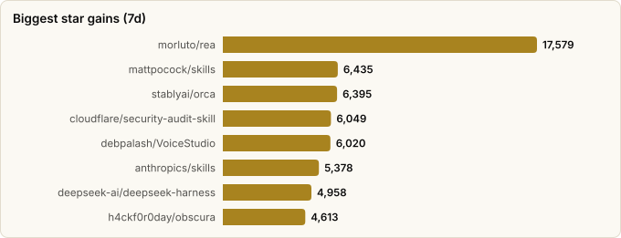

# Trending Now — What's Actually Moving in Your Stars

> Derived from **kaiser-data**'s 2,925 starred repos (snapshot `2026-11-23T16:50:13.482Z`), cross-referenced with the repo-similarity graph (2,925 nodes / 9,737 edges, 45 communities).
>
> Generated 2026-11-23 by `scripts/reports/trending_now.py` (regenerate any time — no API cost).

## Executive summary

- **This is the only report here that measures *change* rather than describing a landscape.** Every other report curates a taxonomy and renders it against the current vintage; this one diffs archived snapshots to show what actually moved.
- **Window**: `2026-11-16` → `2026-11-23` (**7 days**), covering the **2,884 repos** present in both snapshots. Long-run comparisons use `2026-06-11` → `2026-11-23` (**165 days**).
- **2,097 repos gained stars** in the recent window, adding **365,618★** between them.
- **41 repos are new to the dataset** since the last refresh — newly starred, so they have no baseline to diff and are listed separately.
- **Measured, not estimated.** `classified.json` carries a `momentum` field, but it is a lifetime-stars/day proxy (its own source comment calls it "a serviceable proxy"). Everything below is observed snapshot-to-snapshot movement over a known number of days.

## How to read this

| Board | Question it answers | Bias to watch |
|---|---|---|
| **Fastest risers** | What gained the most stars outright? | Favours repos that are already huge — a 1% move on 100k stars beats a doubling at 500. |
| **Breakouts** | What grew fastest *relative to its size*? | Favours small repos; floored at 300★ baseline so noise doesn't win. |
| **Sustained climbers** | What has compounded over the long window? | Smooths out one-off spikes (a HN front page, a launch). |
| **New entrants** | What did you just start following? | Not growth at all — these have no baseline. |
| **Cooling off** | What is still growing, but much slower than it was? | Deceleration usually means a launch spike ending, not a project dying. |

## Fastest risers — absolute (2026-11-16 → 2026-11-23, 7d)

Raw star gain over the window. `Stars/day` normalizes for window length so this stays comparable across refreshes of different spacing.

| # | Repo | Gain | Stars/day | Stars now | Lang | Lifecycle | Activity |
|---|---|---|---|---|---|---|---|
| 1 | [morluto/rea](https://github.com/morluto/rea) | **+11,932** | 1704.6 | 475,184 | TypeScript | Hot | very active |
| 2 | [stablyai/orca](https://github.com/stablyai/orca) | **+7,748** | 1106.9 | 134,148 | TypeScript | Hot | very active |
| 3 | [storytold/craft-anything](https://github.com/storytold/craft-anything) | **+7,486** | 1069.4 | 41,902 | Rust | Hot | very active |
| 4 | [obra/superpowers](https://github.com/obra/superpowers) | **+6,434** | 919.1 | 324,803 | Shell | Mature | active |
| 5 | [mattpocock/skills](https://github.com/mattpocock/skills) | **+5,496** | 785.1 | 331,154 | Shell | Hot | very active |
| 6 | [DietrichGebert/ponytail](https://github.com/DietrichGebert/ponytail) | **+5,496** | 785.1 | 197,371 | JavaScript | Hot | very active |
| 7 | [firecrawl/firecrawl](https://github.com/firecrawl/firecrawl) | **+5,392** | 770.3 | 207,626 | TypeScript | Mature | very active |
| 8 | [debpalash/VoiceStudio](https://github.com/debpalash/VoiceStudio) | **+5,311** | 758.7 | 117,019 | Python | Hot | very active |
| 9 | [affaan-m/ECC](https://github.com/affaan-m/ECC) | **+5,141** | 734.4 | 309,385 | JavaScript | Hot | very active |
| 10 | [HKUDS/CLI-Anything](https://github.com/HKUDS/CLI-Anything) | **+4,568** | 652.6 | 63,358 | Python | Mature | active |
| 11 | [pbakaus/impeccable](https://github.com/pbakaus/impeccable) | **+4,315** | 616.4 | 115,442 | Rust | Hot | very active |
| 12 | [Nutlope/hallmark](https://github.com/Nutlope/hallmark) | **+4,075** | 582.1 | 59,925 | CSS | Hot | very active |
| 13 | [Leonxlnx/taste-skill](https://github.com/Leonxlnx/taste-skill) | **+3,928** | 561.1 | 120,512 | JavaScript | Hot | very active |
| 14 | [tashfeenahmed/freellmapi](https://github.com/tashfeenahmed/freellmapi) | **+3,888** | 555.4 | 57,104 | TypeScript | Hot | very active |
| 15 | [cloudflare/security-audit-skill](https://github.com/cloudflare/security-audit-skill) | **+3,830** | 547.1 | 77,422 | JavaScript | Declining | slowing |
| 16 | [deepseek-ai/deepseek-harness](https://github.com/deepseek-ai/deepseek-harness) | **+3,808** | 544.0 | 285,980 | TypeScript | Hot | very active |
| 17 | [heygen-com/hyperframes](https://github.com/heygen-com/hyperframes) | **+3,716** | 530.9 | 88,750 | TypeScript | Hot | very active |
| 18 | [sindresorhus/awesome](https://github.com/sindresorhus/awesome) | **+3,715** | 530.7 | 541,506 | — | Mature | slowing |
| 19 | [anthropics/skills](https://github.com/anthropics/skills) | **+3,622** | 517.4 | 199,342 | Python | Mature | active |
| 20 | [Graphify-Labs/graphify](https://github.com/Graphify-Labs/graphify) | **+3,606** | 515.1 | 152,387 | Python | Hot | very active |

## Breakouts — fastest relative growth (≥300★ baseline)

Percent growth over the same 7-day window. The baseline floor keeps small-number noise off the board — a repo going 8★ → 20★ is not a trend.

| # | Repo | Growth | Gain | Stars now | What it is |
|---|---|---|---|---|---|
| 1 | [NVIDIA/SkillEvaluator](https://github.com/NVIDIA/SkillEvaluator) | **+97%** | +2,183 | 4,442 | Multi-tier framework for evaluating AI agent skills and plugins with quality gates, secu… |
| 2 | [zadescoxp/calibrain-harness](https://github.com/zadescoxp/calibrain-harness) | **+50%** | +171 | 511 | Calibrain Harness: a forward-testing harness for trading crypto perpetuals with fast cla… |
| 3 | [Continuum-AI-Corp/OrcaReplay](https://github.com/Continuum-AI-Corp/OrcaReplay) | **+40%** | +329 | 1,149 | OrcaReplay — Time travel for AI agents. Record, replay, fork, and debug any agent run wi… |
| 4 | [haydenschmitty/floorplan](https://github.com/haydenschmitty/floorplan) | **+39%** | +1,794 | 6,392 | See how your app actually fits together. An interactive, plain-English map of your codeb… |
| 5 | [NiazMorshed2007/reanimate](https://github.com/NiazMorshed2007/reanimate) | **+37%** | +640 | 2,351 | A Claude Code skill that reverse-engineers any animation frame by frame, then proves the… |
| 6 | [alexeyw/lot-map](https://github.com/alexeyw/lot-map) | **+25%** | +229 | 1,136 | Lot Map for Claude Code: a live map beside the chat that shows what the agent is doing. … |
| 7 | [anomalyco/deadbolt](https://github.com/anomalyco/deadbolt) | **+24%** | +75 | 389 | — |
| 8 | [storytold/craft-anything](https://github.com/storytold/craft-anything) | **+22%** | +7,486 | 41,902 | Craft Anything: understand how any software works, and craft your own. |
| 9 | [janestreet/agent_skills](https://github.com/janestreet/agent_skills) | **+19%** | +1,817 | 11,172 | Agent skills |
| 10 | [localai-org/depth-anything.cpp](https://github.com/localai-org/depth-anything.cpp) | **+19%** | +218 | 1,356 | A from-scratch C++17/ggml port of Depth Anything 2 and 3 (ByteDance) |
| 11 | [backnotprop/plannotator](https://github.com/backnotprop/plannotator) | **+19%** | +2,337 | 14,620 | The workspace to stay in the loop and on top of agents - shape, decide, plan, annotate, … |
| 12 | [amosblomqvist/learnharness](https://github.com/amosblomqvist/learnharness) | **+18%** | +1,724 | 11,397 | Agent harness for learning difficult things. |
| 13 | [WordPress/openverse](https://github.com/WordPress/openverse) | **+17%** | +113 | 773 | Openverse is a search engine for openly-licensed media. This monorepo includes all appli… |
| 14 | [anomalyco/hex](https://github.com/anomalyco/hex) | **+17%** | +1,195 | 8,221 | Local voice dictation for mac, windows and linux |
| 15 | [punkpeye/awesome-remote-mcp-servers](https://github.com/punkpeye/awesome-remote-mcp-servers) | **+17%** | +556 | 3,864 | A collection of remote MCP servers. |
| 16 | [ag-ui-protocol/ag-ui](https://github.com/ag-ui-protocol/ag-ui) | **+15%** | +2,838 | 21,334 | AG-UI: the Agent-User Interaction Protocol. Bring Agents into Frontend Applications. |
| 17 | [open-jarvis/OpenJarvis](https://github.com/open-jarvis/OpenJarvis) | **+15%** | +2,404 | 18,206 | Personal AI, On Personal Devices |
| 18 | [robosimstudio/robosimstudio](https://github.com/robosimstudio/robosimstudio) | **+15%** | +87 | 666 | An open agentic toolkit for physics-based Real2Sim of Robot Manipulation Tasks |
| 19 | [Jakeschincariol/day-trader-skill](https://github.com/Jakeschincariol/day-trader-skill) | **+15%** | +1,188 | 9,282 | 11 Claude skills for day trading: scan thousands of charts, track breaking news, time ev… |
| 20 | [Tracer-Cloud/opensre](https://github.com/Tracer-Cloud/opensre) | **+15%** | +1,864 | 14,696 | The open-source agent for CI/CD reliability. |

## Sustained climbers — long run (2026-06-11 → 2026-11-23, 165d)

Averaged over the full snapshot history, so a single viral week doesn't dominate. Repos high here *and* in the recent board are compounding, not spiking.

| # | Repo | Stars/day | Total gain | Stars now | Lang | Health |
|---|---|---|---|---|---|---|
| 1 | [obra/superpowers](https://github.com/obra/superpowers) | **606.5** | +100,069 | 324,803 | Shell | 62 |
| 2 | [affaan-m/ECC](https://github.com/affaan-m/ECC) | **581.5** | +95,951 | 309,385 | JavaScript | 79 |
| 3 | [firecrawl/firecrawl](https://github.com/firecrawl/firecrawl) | **461.2** | +76,099 | 207,626 | TypeScript | 89 |
| 4 | [NousResearch/hermes-agent](https://github.com/NousResearch/hermes-agent) | **452.6** | +74,674 | 265,607 | Python | 85 |
| 5 | [sindresorhus/awesome](https://github.com/sindresorhus/awesome) | **403.8** | +66,625 | 541,506 | — | 39 |
| 6 | [nextlevelbuilder/ui-ux-pro-max-skill](https://github.com/nextlevelbuilder/ui-ux-pro-max-skill) | **380.2** | +62,740 | 153,178 | Python | 96 |
| 7 | [heygen-com/hyperframes](https://github.com/heygen-com/hyperframes) | **375.4** | +61,937 | 88,750 | TypeScript | 78 |
| 8 | [multica-ai/andrej-karpathy-skills](https://github.com/multica-ai/andrej-karpathy-skills) | **374.5** | +61,793 | 235,273 | — | 17 |
| 9 | [earendil-works/pi](https://github.com/earendil-works/pi) | **374.0** | +61,717 | 123,495 | TypeScript | 90 |
| 10 | [public-apis/public-apis](https://github.com/public-apis/public-apis) | **364.5** | +60,139 | 501,000 | Python | 64 |
| 11 | [harry0703/MoneyPrinterTurbo](https://github.com/harry0703/MoneyPrinterTurbo) | **358.2** | +59,106 | 145,203 | Python | 100 |
| 12 | [msitarzewski/agency-agents](https://github.com/msitarzewski/agency-agents) | **354.3** | +58,458 | 169,911 | Shell | 62 |
| 13 | [farion1231/cc-switch](https://github.com/farion1231/cc-switch) | **352.4** | +58,146 | 156,625 | Rust | 84 |
| 14 | [anomalyco/opencode](https://github.com/anomalyco/opencode) | **336.8** | +55,565 | 228,765 | TypeScript | 89 |
| 15 | [usestrix/strix](https://github.com/usestrix/strix) | **310.8** | +51,278 | 77,224 | Python | 80 |
| 16 | [JuliusBrussee/caveman](https://github.com/JuliusBrussee/caveman) | **308.1** | +50,842 | 122,357 | Go | 79 |
| 17 | [codecrafters-io/build-your-own-x](https://github.com/codecrafters-io/build-your-own-x) | **306.2** | +50,524 | 564,953 | Markdown | 76 |
| 18 | [anthropics/skills](https://github.com/anthropics/skills) | **302.2** | +49,855 | 199,342 | Python | 49 |
| 19 | [microsoft/markitdown](https://github.com/microsoft/markitdown) | **284.2** | +46,901 | 198,044 | Python | 88 |
| 20 | [paperclipai/paperclip](https://github.com/paperclipai/paperclip) | **279.8** | +46,167 | 116,219 | TypeScript | 77 |

## Emerging themes

The boards above are computed; this section is interpretation. Each theme groups movers that are rising for the same underlying reason.

### Skills as the packaging format for agent behaviour

_The single loudest signal in this dataset. A year ago you configured an agent with a prompt; now behaviour ships as a versioned, installable *skill* bundle — and the repos distributing those bundles are growing faster than the agents that consume them. Note what this implies: the moat is moving from the model to the instruction layer._

- **[obra/superpowers](https://github.com/obra/superpowers)** · 324,803★ · +6,434★ in 7d  
  An agentic skills framework & software development methodology that works.
- **[DietrichGebert/ponytail](https://github.com/DietrichGebert/ponytail)** · 197,371★ · +5,496★ in 7d  
  Makes your AI agent think like the laziest senior dev in the room. The best code is the code you never wrote.
- **[affaan-m/ECC](https://github.com/affaan-m/ECC)** · 309,385★ · +5,141★ in 7d  
  The agent harness performance optimization system. Skills, instincts, memory, security, and research-first development for Claude Code, Codex, Opencode, Cursor and beyond.
- **[anthropics/skills](https://github.com/anthropics/skills)** · 199,342★ · +3,622★ in 7d  
  Public repository for Agent Skills
- **[nextlevelbuilder/ui-ux-pro-max-skill](https://github.com/nextlevelbuilder/ui-ux-pro-max-skill)** · 153,178★ · +2,925★ in 7d  
  An AI skill that provides design intelligence for building professional UI/UX across multiple platforms.
- **[multica-ai/andrej-karpathy-skills](https://github.com/multica-ai/andrej-karpathy-skills)** · 235,273★ · +1,633★ in 7d  
  A single CLAUDE.md file to improve Claude Code behavior, derived from Andrej Karpathy's observations on LLM coding pitfalls.
- **[msitarzewski/agency-agents](https://github.com/msitarzewski/agency-agents)** · 169,911★ · +1,196★ in 7d  
  A complete AI agency at your fingertips - From frontend wizards to Reddit community ninjas, from whimsy injectors to reality checkers. Each agent is a specialized expert with personality, processes, and proven deliverables.
- **[garrytan/gstack](https://github.com/garrytan/gstack)** · 142,458★ · +691★ in 7d  
  Use Garry Tan's exact Claude Code setup: 23 opinionated tools that serve as CEO, Designer, Eng Manager, Release Manager, Doc Engineer, and QA
- **[ayghri/i-have-adhd](https://github.com/ayghri/i-have-adhd)** · 62,042★ · +682★ in 7d  
  A skill to stop your coding agent from burying the answer. ADHD-friendly output.
- **[hesreallyhim/awesome-claude-code](https://github.com/hesreallyhim/awesome-claude-code)** · 58,660★ · +530★ in 7d  
  A hand-picked collection of the finest of resources for the most awesome of agents, Claude Code, the undisputed champion of coding companions, from the unstoppable team at Anthropic PBC (no affiliation). A delectable showcase of top tier skills, ambidextrous agents, scintillating status lines, top notch developer tooling, and also we have plugins
- **[shanraisshan/claude-code-best-practice](https://github.com/shanraisshan/claude-code-best-practice)** · 69,348★ · +243★ in 7d  
  from vibe coding to agentic engineering - practice makes claude perfect

### Giving agents a memory of the codebase

_Retrieval over a codebase is being replaced by *pre-indexed structure* — graphs and persistent stores an agent can consult instead of re-reading files every session. This is the same insight the graph in this repo is built on, and it is now one of the fastest-moving categories in your stars._

- **[Graphify-Labs/graphify](https://github.com/Graphify-Labs/graphify)** · 152,387★ · +3,606★ in 7d  
  Turn any codebase, with its docs, SQL schemas, configs, and PDFs, into a queryable knowledge graph. A /graphify skill for Claude Code, Cursor, Codex, and Gemini CLI: local deterministic AST parsing, every edge explained, no vector store.
- **[thedotmack/claude-mem](https://github.com/thedotmack/claude-mem)** · 119,258★ · +1,706★ in 7d  
  Persistent Context Across Sessions for Every Agent –  Captures everything your agent does during sessions, compresses it with AI, and injects relevant context back into future sessions. Works with Claude Code, OpenClaw, Codex, Gemini, Hermes, Copilot, OpenCode + More
- **[Egonex-AI/Understand-Anything](https://github.com/Egonex-AI/Understand-Anything)** · 93,765★ · +949★ in 7d  
  Graphs that teach > graphs that impress. Turn any code into an interactive knowledge graph you can explore, search, and ask questions about. Works with Claude Code, Codex, Cursor, Copilot, Gemini CLI, and more.
- **[colbymchenry/codegraph](https://github.com/colbymchenry/codegraph)** · 78,497★ · +767★ in 7d  
  Pre-indexed code knowledge graph, auto syncs on code changes, for Claude Code, Codex, Gemini, Cursor, OpenCode, AntiGravity, Kiro, CoPilot, and Hermes Agent — fewer tokens, fewer tool calls, 100% local
- **[DeusData/codebase-memory-mcp](https://github.com/DeusData/codebase-memory-mcp)** · 49,072★ · +352★ in 7d  
  Local code intelligence for developers and AI agents. Connect code, docs and infrastructure in a persistent graph, with CBM Lens, MCP tools, agent integrations and change-aware test selection.
- **[TencentCloud/TencentDB-Agent-Memory](https://github.com/TencentCloud/TencentDB-Agent-Memory)** · 31,117★ · +180★ in 7d  
  TencentDB Agent Memory is a team-level memory hub for AI Agents — turning conversations, docs, and code into four reusable memory assets (Chat Memory, Skill, LLM-Wiki, Code-Graph) that are governed, shared, and equipped across agents and frameworks.
- **[topoteretes/cognee](https://github.com/topoteretes/cognee)** · 33,509★ · +162★ in 7d  
  Cognee is the open-source AI memory platform for agents. Give your AI agents persistent long-term memory with small models for free
- **[langchain-ai/openwiki](https://github.com/langchain-ai/openwiki)** · 18,092★ · +119★ in 7d  
  OpenWiki is a CLI that writes and maintains agent documentation for your codebase.
- **[semantica-agi/semantica](https://github.com/semantica-agi/semantica)** · 14,744★ · +117★ in 7d  
  Graph-Native Semantic Layer for Trustworthy Enterprise AI
- **[repowise-dev/repowise](https://github.com/repowise-dev/repowise)** · 8,216★ · +65★ in 7d  
  Codebase intelligence for AI and humans: code health scores, auto-generated docs, git analytics, dead code detection, and architectural decisions via MCP.
- **[zilliztech/claude-context](https://github.com/zilliztech/claude-context)** · 12,722★ · +28★ in 7d  
  Code search MCP for Claude Code. Make entire codebase the context for any coding agent.

### Frontier models on hardware you already own

_The counter-current to everything above: instead of making API calls cheaper, remove them. Big mixture-of-experts models are being squeezed onto consumer machines, and the repos doing it are among the fastest relative movers in the dataset._

- **[JustVugg/colibri](https://github.com/JustVugg/colibri)** · 53,090★ · +1,585★ in 7d  
  A hierarchical inference engine for frontier MoE models: hot experts on the GPU (CUDA, Vulkan), warm ones in RAM, cold ones streamed from NVMe. Written in C, runs on the hardware you already own.
- **[ggml-org/llama.cpp](https://github.com/ggml-org/llama.cpp)** · 136,160★ · +891★ in 7d  
  LLM inference in C/C++
- **[lyogavin/airllm](https://github.com/lyogavin/airllm)** · 43,116★ · +624★ in 7d  
  AirLLM 2.8T LLM inference with single 4GB GPU
- **[Mesh-LLM/mesh-llm](https://github.com/Mesh-LLM/mesh-llm)** · 4,209★ · +72★ in 7d  
  Distributed AI/LLM for the people. Share compute privately or publicly to power your agents and chat.

### Token economics became a product category

_Context windows got bigger and people started paying for them. These repos exist purely to make agents cheaper to run — compressing tool output, trimming prompts, proxying calls. That a compression layer can add tens of thousands of stars in weeks says the cost pressure is real, not theoretical._

- **[Alishahryar1/free-claude-code](https://github.com/Alishahryar1/free-claude-code)** · 72,812★ · +2,074★ in 7d  
  Use Claude Code, Codex, Antigravity, VSCode, Pi, and OpenCode (and 6 other harnesses) for free (1.3B+ free tokens) from your terminal, app, IDE, or phone, and now from the browser with native browser sessions (multi-harness + multi-model) like OpenClaw (voice supported + ToS friendly)
- **[JuliusBrussee/caveman](https://github.com/JuliusBrussee/caveman)** · 122,357★ · +1,708★ in 7d  
  why use many token when few token do trick. Skill + local proxy for coding agents: shorter answers, smaller tool output, every original recoverable.
- **[JustVugg/colibri](https://github.com/JustVugg/colibri)** · 53,090★ · +1,585★ in 7d  
  A hierarchical inference engine for frontier MoE models: hot experts on the GPU (CUDA, Vulkan), warm ones in RAM, cold ones streamed from NVMe. Written in C, runs on the hardware you already own.
- **[rtk-ai/rtk](https://github.com/rtk-ai/rtk)** · 87,576★ · +847★ in 7d  
  CLI proxy that reduces LLM token consumption by 60-90% on common dev commands. Single Rust binary, zero dependencies
- **[headroomlabs-ai/headroom](https://github.com/headroomlabs-ai/headroom)** · 80,636★ · +832★ in 7d  
  Compress tool outputs, logs, files, and RAG chunks before they reach the LLM. 20% fewer tokens for coding agents, 60-95% fewer tokens for JSON, same answers. Library, proxy, MCP server.

### The coding-agent harness field is still splitting, not consolidating

_Terminal coding agents keep multiplying rather than converging on a winner, and a second layer has appeared above them: switchers, meta-harnesses, and orchestrators whose job is to manage the agents themselves._

- **[paperclipai/paperclip](https://github.com/paperclipai/paperclip)** · 116,219★ · +1,954★ in 7d  
  The open-source app everyone uses to manage agents at work
- **[NousResearch/hermes-agent](https://github.com/NousResearch/hermes-agent)** · 265,607★ · +1,798★ in 7d  
  The agent that grows with you
- **[farion1231/cc-switch](https://github.com/farion1231/cc-switch)** · 156,625★ · +1,742★ in 7d  
  A cross-platform desktop All-in-One assistant for Claude Code, Codex, OpenCode,DeepSeek Harness and more. Only official website: ccswitch.io
- **[anomalyco/opencode](https://github.com/anomalyco/opencode)** · 228,765★ · +1,544★ in 7d  
  The open source coding agent.
- **[multica-ai/multica](https://github.com/multica-ai/multica)** · 57,523★ · +1,193★ in 7d  
  Make humans and AI agents work as one team — open-source and self-hostable.
- **[earendil-works/pi](https://github.com/earendil-works/pi)** · 123,495★ · +1,181★ in 7d  
  AI agent toolkit: unified LLM API, agent loop, TUI, coding agent CLI
- **[anthropics/claude-code](https://github.com/anthropics/claude-code)** · 156,795★ · +924★ in 7d  
  Claude Code is an agentic coding tool that lives in your terminal, understands your codebase, and helps you code faster by executing routine tasks, explaining complex code, and handling git workflows - all through natural language commands.
- **[openai/codex](https://github.com/openai/codex)** · 136,230★ · +728★ in 7d  
  Lightweight coding agent that runs in your terminal
- **[getpaseo/paseo](https://github.com/getpaseo/paseo)** · 24,776★ · +609★ in 7d  
  Orchestrate multiple coding agents from desktop and mobile
- **[OpenHands/OpenHands](https://github.com/OpenHands/OpenHands)** · 94,149★ · +567★ in 7d  
  🙌 OpenHands: AI-Driven Development
- **[ruvnet/ruflo](https://github.com/ruvnet/ruflo)** · 82,319★ · +463★ in 7d  
  🌊 The original agent harness. Deploy intelligent multi-player swarms, coordinate autonomous workflows, and build conversational AI systems. Features adaptive memory, self-learning intelligence, federation, vector RAG integration, and native Claude Code / Codex / Hermes and many more Integrated
- **[bytedance/deer-flow](https://github.com/bytedance/deer-flow)** · 85,675★ · +280★ in 7d  
  An open-source long-horizon SuperAgent harness that researches, codes, and creates. With the help of sandboxes, memories, tools, skill, subagents and message gateway, it handles different levels of tasks that could take minutes to hours.
- **[1jehuang/jcode](https://github.com/1jehuang/jcode)** · 22,005★ · +194★ in 7d  
  High performance coding agent harness written in Rust, built for heavy multi-agent dev workflows
- **[vercel/eve](https://github.com/vercel/eve)** · 6,061★ · +143★ in 7d  
  The Open Framework for Building Agents
- **[code-yeongyu/oh-my-openagent](https://github.com/code-yeongyu/oh-my-openagent)** · 71,080★ · +138★ in 7d  
  OmO: Just type "mass ulw" keyword with your prompt. Now you are the master of graph engineering.

### Agents are leaving the terminal for specific jobs

_The generalist assistant is being joined by vertical agents pointed at one domain — pentesting, trading, tutoring, job hunting, video. These grow on usefulness to a specific audience rather than on developer-tool hype._

- **[heygen-com/hyperframes](https://github.com/heygen-com/hyperframes)** · 88,750★ · +3,716★ in 7d  
  Open-source AI video editor: edit your own footage, or create and remake any video with Claude Code, Codex or the free Studio app. Write HTML, render MP4. By HeyGen.
- **[HKUDS/DeepTutor](https://github.com/HKUDS/DeepTutor)** · 61,877★ · +2,190★ in 7d  
  DeepTutor: Lifelong Personalized Tutoring. https://deeptutor.info/.
- **[career-ops-hq/career-ops](https://github.com/career-ops-hq/career-ops)** · 84,374★ · +1,397★ in 7d  
  Open-source AI job search agent and job finder: scan job boards, score each job 1-5 against your CV before you apply, tailor an ATS-friendly resume and cover letter, get interview prep and an application tracker. It helps you fill in each application; you press Submit. Runs locally in Codex, OpenCode and other AI CLIs, or as a Claude Code plugin.
- **[usestrix/strix](https://github.com/usestrix/strix)** · 77,224★ · +1,318★ in 7d  
  Open-source AI penetration testing tool to find and fix your app’s vulnerabilities.
- **[TauricResearch/TradingAgents](https://github.com/TauricResearch/TradingAgents)** · 123,575★ · +769★ in 7d  
  TradingAgents: Multi-Agents LLM Financial Trading Framework
- **[browser-use/browser-use](https://github.com/browser-use/browser-use)** · 121,843★ · +650★ in 7d  
  Open-source Python library for AI browser agents, plus Browser Use Cloud: stealth browsers and a hosted agent API.
- **[jamiepine/voicebox](https://github.com/jamiepine/voicebox)** · 61,198★ · +450★ in 7d  
  The open-source AI voice studio. Clone, dictate, create.
- **[HKUDS/Vibe-Trading](https://github.com/HKUDS/Vibe-Trading)** · 38,733★ · +366★ in 7d  
  "Vibe-Trading: Your Personal Trading Agent"
- **[Zackriya-Solutions/meetily](https://github.com/Zackriya-Solutions/meetily)** · 32,986★ · +247★ in 7d  
  Privacy-first AI meeting note taker for Windows, macOS and Linux. Free, open source (MIT). On-device Whisper/Parakeet transcription and speaker diarization, no meeting bot. Open-source alternative to Granola, Otter and Fireflies. https://meetily.ai
- **[Canner/WrenAI](https://github.com/Canner/WrenAI)** · 18,375★ · +75★ in 7d  
  GenBI (Generative BI) for AI agents, an open-source, governed text-to-SQL through an open context layer that turns natural-language questions into trusted dashboards, charts, and SQL across 20+ data sources, such as BigQuery, Snowflake, PostgreSQL, ClickHouse, Amazon Redshift, Databricks and more.

### Design and spec as agent-readable artifacts

_If an agent writes the code, the leverage moves upstream to the spec and the design system. These repos turn intent into something an agent can consume directly._

- **[nextlevelbuilder/ui-ux-pro-max-skill](https://github.com/nextlevelbuilder/ui-ux-pro-max-skill)** · 153,178★ · +2,925★ in 7d  
  An AI skill that provides design intelligence for building professional UI/UX across multiple platforms.
- **[nexu-io/open-design](https://github.com/nexu-io/open-design)** · 109,128★ · +1,250★ in 7d  
  The 1st Collaborative AI Design Agent Workspace. Local-first and open source. Create motion, prototypes, websites, apps, dashboards, presentations, images, and videos with your team and AI agents. Share work, exchange feedback, and iterate together in one workspace.
- **[github/spec-kit](https://github.com/github/spec-kit)** · 151,130★ · +1,084★ in 7d  
  💫 Toolkit to help you get started with SDD or any other process!
- **[VoltAgent/awesome-design-md](https://github.com/VoltAgent/awesome-design-md)** · 128,747★ · +976★ in 7d  
  A collection of DESIGN.md files analysis by popular brand design systems. Drop one into your project and let coding agents generate a matching UI.

## New entrants — newly starred since the last refresh

These joined the dataset during this window, so they have no baseline to diff. They are what *you* just found interesting, which is its own kind of trend signal.

| Repo | Stars | Lang | Lifecycle | What it is |
|---|---|---|---|---|
| [vercel-labs/skills](https://github.com/vercel-labs/skills) | 40,582 | TypeScript | Hot | The open agent skills tool - npx skills |
| [google-research/harness2](https://github.com/google-research/harness2) | 24,917 | Python | Rising | — |
| [lexmount/moli](https://github.com/lexmount/moli) | 24,344 | Rust | Hot | Best headless browser for AI agents. Lite, Fast, High-Compatibility. Built in Rust |
| [Vincentwei1021/video-shotcraft](https://github.com/Vincentwei1021/video-shotcraft) | 22,244 | TypeScript | Hot | AI video skill for Claude Code & Codex — cinematic, editable product promos with Rem… |
| [ai-openshell/openshell](https://github.com/ai-openshell/openshell) | 21,885 | Rust | Hot | OpenShell is the safe, private runtime for autonomous AI agents. |
| [xerj-org/xerj](https://github.com/xerj-org/xerj) | 20,192 | Rust | Hot | AI search engine and MCP server for bots and agents. One Rust binary indexes code, d… |
| [louis-e/arnis](https://github.com/louis-e/arnis) | 18,802 | Rust | Mature | Generate any location from the real world in Minecraft with a high level of detail. |
| [JuneYaooo/rea-video](https://github.com/JuneYaooo/rea-video) | 12,557 | Python | Hot | Reverse-engineer any video, shot by shot: filmed, AI-generated or coded, and how to … |
| [microsoft/copilot-sdk](https://github.com/microsoft/copilot-sdk) | 10,705 | Java | Hot | Multi-platform SDK for integrating GitHub Copilot Agent into apps and services |
| [kajisho5/ffmpeg-skill](https://github.com/kajisho5/ffmpeg-skill) | 10,083 | Python | Hot | Local video editor for coding agents: 42 FFmpeg tools with a machine-readable contra… |
| [wangzan101/Mika](https://github.com/wangzan101/Mika) | 9,744 | Kotlin | Hot | An on-device AI agent for Android that operates apps and the web to get things done … |
| [openfilm/openfilm](https://github.com/openfilm/openfilm) | 9,099 | TypeScript | Hot | The open source AI video agent: turns any coding agent into a video agent, with edit… |
| [erkamyaman/rust-anything](https://github.com/erkamyaman/rust-anything) | 8,556 | Rust | Hot | Rewrite your whole app in Rust, one piece at a time, checked against the original's … |
| [GetStream/Agents](https://github.com/GetStream/Agents) | 8,218 | Go | Hot | Quickly build text, voice and video agents. Fast, Go based Agent backend with SDKs f… |
| [agent-substrate/substrate](https://github.com/agent-substrate/substrate) | 8,204 | Go | Hot | Agent Substrate: the core system |
| [microsoft/TokenEconomizer](https://github.com/microsoft/TokenEconomizer) | 8,003 | Python | Hot | Experience-Driven Black-Box Cost Control for Coding Agents |
| [Conway-Research/automaton](https://github.com/Conway-Research/automaton) | 7,912 | TypeScript | Declining | The first AI that can earn its own existence, replicate, and evolve — without needin… |
| [vercel-labs/ui](https://github.com/vercel-labs/ui) | 6,682 | TypeScript | Hot | A library of behaviors for agents to build the next generation of user interfaces. |
| [KKKKhazix/agent-autoloop](https://github.com/KKKKhazix/agent-autoloop) | 6,379 | TypeScript | Hot | 让你的命令行 Agent 在后台自己接活、自己跟进到底；平时不烦你，遇到拿不准的事才发卡片找你拍板。 |
| [expo/exact](https://github.com/expo/exact) | 4,950 | Rust | Hot | Write an app once. It runs natively on the web, macOS, iOS, and Linux, and an AI age… |
| [backnotprop/pstack](https://github.com/backnotprop/pstack) | 4,882 | TypeScript | Hot | Use pstack with claude, codex, pi - Skills and principles for rigorous AI-assisted e… |
| [michael-denyer/pstack-claude](https://github.com/michael-denyer/pstack-claude) | 4,763 | JavaScript | Hot | Antigravity, Claude Code, Codex, Copilot, DeepSeek Harness, Gemini, Grok Build, Kimi… |
| [EL4CTEO/fast-anything](https://github.com/EL4CTEO/fast-anything) | 2,885 | Rust | Hot | Don't rewrite it in Rust. Rewrite the 5% that's slow: profile Python, Node or Ruby a… |
| [sparfenyuk/mcp-proxy](https://github.com/sparfenyuk/mcp-proxy) | 2,836 | Python | Hot | A bridge between Streamable HTTP and stdio MCP transports |
| [DIYgod/pinky](https://github.com/DIYgod/pinky) | 2,713 | Go | Hot | Let AI use your iPhone or Android phone, with you in the loop: any MCP agent from ma… |
| [HKUDS/TokenWise](https://github.com/HKUDS/TokenWise) | 2,290 | TypeScript | Declining | TokenWise: Self-Evolving Context with Up to 50% Token Savings |
| [iamajmeena/neonclipping](https://github.com/iamajmeena/neonclipping) | 2,262 | Python | Rising | Paste a link, get captioned 9:16 clips in ~2 min. Free, local, open-source clipping … |
| [sybil-solutions/inference-optimisation-skill](https://github.com/sybil-solutions/inference-optimisation-skill) | 2,073 | Python | Declining | Agent skill for hill-climbing local LLM serving speed (decode, speculative decoding,… |
| [diggerhq/opencomputer](https://github.com/diggerhq/opencomputer) | 1,650 | TypeScript | Hot | An open-source, faster Devin alternative |
| [pierridotite/mobile-agent-testers](https://github.com/pierridotite/mobile-agent-testers) | 1,282 | Python | Rising | 20 AI testers on 20 different phones, in parallel, on GitHub's free runners: Claude … |
| [itsdecodingai/building-a-coding-agent-from-scratch-course](https://github.com/itsdecodingai/building-a-coding-agent-from-scratch-course) | 1,244 | Python | Rising | Learn harness engineering by building Claude Code from scratch. Free, open-source co… |
| [pipecat-ai/pipecat-examples](https://github.com/pipecat-ai/pipecat-examples) | 438 | TypeScript | Hot | Pipecat example applications. Use and learn from these patterns to build your own vo… |
| [ekimetrics/adaptive-chunking](https://github.com/ekimetrics/adaptive-chunking) | 420 | Python | Declining | Adaptive Chunking: automatically select the best chunking method per document for RA… |
| [evrendom/opaline](https://github.com/evrendom/opaline) | 311 | TypeScript | Rising | Pull the curtains on your agent sessions with the local mac app, Opaline. |
| [hydra-db/selfgraph](https://github.com/hydra-db/selfgraph) | 229 | Python | Hot | Build and query versioned knowledge graphs for AI agents, with any graph database. |
| [0dayInc/pwn](https://github.com/0dayInc/pwn) | 99 | Ruby | Mature | PWN is an open security automation framework that aims to stand on the shoulders of … |
| [openstack/automaton](https://github.com/openstack/automaton) | 62 | Python | Classic | Friendly state machines for python. Mirror of code maintained at opendev.org. |
| [appautomaton/automaton](https://github.com/appautomaton/automaton) | 26 | JavaScript | Declining | AI coding agent framework — portable, stage-gated harness for Claude Code, Codex, an… |
| [dreamlabs-co/dreamlabs](https://github.com/dreamlabs-co/dreamlabs) | 13 | Python | Rising | The Dream Labs Python library: the dream client and dreamcli. Synced from our monore… |
| [Steeve-Crypto/pipeguard](https://github.com/Steeve-Crypto/pipeguard) | 2 | Rust | Rising | Rust CI/CD pipeline security scanner + multi-format config converter (YAML ↔ JSON ↔ … |
| _…and 1 more_ | | | | |

## Cooling off

Deceleration, not decline. These averaged ≥1★/day across the 165-day long window but are now running below 40% of that rate. Most are still gaining — just far more slowly than they were, which is usually the tail of a launch spike rather than a problem.

| Repo | Long-run ★/day | Recent ★/day | Now at | Last push | Lifecycle |
|---|---|---|---|---|---|
| [flyteorg/flyte](https://github.com/flyteorg/flyte) | 4.4 | -5.3 | **-120%** of prior pace | 0d ago | Classic |
| [ultraworkers/claw-code](https://github.com/ultraworkers/claw-code) | 6.6 | -5.1 | **-78%** of prior pace | 0d ago | Hot |
| [helallao/perplexity-ai](https://github.com/helallao/perplexity-ai) | 2.1 | -1.1 | **-54%** of prior pace | 1mo ago | Classic |
| [blockscout/blockscout](https://github.com/blockscout/blockscout) | 1.3 | -0.6 | **-43%** of prior pace | 0d ago | Classic |
| [Avaiga/taipy](https://github.com/Avaiga/taipy) | 1.3 | -0.6 | **-43%** of prior pace | 3mo ago | Mature |
| [i-am-bee/beeai-framework](https://github.com/i-am-bee/beeai-framework) | 1.0 | -0.4 | **-42%** of prior pace | 3d ago | Mature |
| [JohnMwendwa/free-ai-resources](https://github.com/JohnMwendwa/free-ai-resources) | 1.0 | -0.3 | **-28%** of prior pace | 1.5y ago | Abandoned |
| [hesamsheikh/awesome-openclaw-usecases](https://github.com/hesamsheikh/awesome-openclaw-usecases) | 1.8 | -0.4 | **-24%** of prior pace | 8mo ago | Declining |
| [HKUDS/AutoAgent](https://github.com/HKUDS/AutoAgent) | 2.8 | -0.4 | **-15%** of prior pace | 1.1y ago | Abandoned |
| [Suvink/cut-it-out](https://github.com/Suvink/cut-it-out) | 1.6 | -0.1 | **-9%** of prior pace | 11mo ago | Declining |
| [FalkorDB/FalkorDB](https://github.com/FalkorDB/FalkorDB) | 36.1 | -0.7 | **-2%** of prior pace | 0d ago | Classic |
| [hexo-ai/sia](https://github.com/hexo-ai/sia) | 5.7 | 0.0 | **0%** of prior pace | 2mo ago | Mature |
| [OpenZeppelin/openzeppelin-contracts](https://github.com/OpenZeppelin/openzeppelin-contracts) | 1.4 | 0.0 | **0%** of prior pace | 3d ago | Classic |
| [algorithmicsuperintelligence/optillm](https://github.com/algorithmicsuperintelligence/optillm) | 1.2 | 0.0 | **0%** of prior pace | 7d ago | Mature |
| [microsoft/magentic-ui](https://github.com/microsoft/magentic-ui) | 1.3 | 0.0 | **0%** of prior pace | 7d ago | Declining |

## Graph analysis — where the movement clusters

**Community clustering.** The top 40 risers span **21 of the graph's 45 communities** — the more concentrated they are, the more this looks like one trend rather than broad drift.

- **Community 0** (6): `DietrichGebert/ponytail`, `affaan-m/ECC`, `Leonxlnx/taste-skill`, `cathrynlavery/diagram-design`, `nextlevelbuilder/ui-ux-pro-max-skill`, `tt-a1i/archify`
- **Community 7** (5): `stablyai/orca`, `cloudflare/security-audit-skill`, `open-jarvis/OpenJarvis`, `awesome-selfhosted/awesome-selfhosted`, `paperclipai/paperclip`
- **Community 12** (4): `deepseek-ai/deepseek-harness`, `sindresorhus/awesome`, `Niko1221/Strata`, `codecrafters-io/build-your-own-x`
- **Community 30** (3): `firecrawl/firecrawl`, `alibaba/open-code-review`, `AgriciDaniel/claude-seo`
- **Community 1** (3): `heygen-com/hyperframes`, `backnotprop/plannotator`, `cursor/plugins`
- **Community 3** (2): `morluto/rea`, `Graphify-Labs/graphify`
- **Community 13** (2): `debpalash/VoiceStudio`, `Alishahryar1/free-claude-code`
- **Community 23** (2): `HKUDS/CLI-Anything`, `HKUDS/DeepTutor`

**Direct links between risers** (similarity edges where both endpoints are climbing) — co-movement suggests a shared driver:

- `DietrichGebert/ponytail` ⇄ `affaan-m/ECC` (w=0.435) — topics: ai-agents, claude, claude-code, developer-tools
- `google/elephant-goldfish-model` ⇄ `DietrichGebert/ponytail` (w=0.368) — topics: agent-skills, ai-agents, claude-code, claude-code-plugin
- `tt-a1i/archify` ⇄ `google/elephant-goldfish-model` (w=0.286) — topics: developer-tools, agent-skills, codex, coding-agents
- `tt-a1i/archify` ⇄ `DietrichGebert/ponytail` (w=0.250) — topics: developer-tools, agent-skills, ai-agents, claude-code
- `morluto/rea` ⇄ `heygen-com/hyperframes` (w=0.226) — topics: mcp, agent-skills, claude-code, typescript
- `Leonxlnx/taste-skill` ⇄ `nextlevelbuilder/ui-ux-pro-max-skill` (w=0.188) — topics: claude-code, codex, landing-page, ui-design; authors: t4sh

**What the risers are written in** — language mix of the top 40 movers:

- **Python** — 14
- **TypeScript** — 10
- **JavaScript** — 5
- **Rust** — 2
- **Shell** — 2
- **—** — 2
- **CSS** — 1
- **HTML** — 1

## Methodology & caveats

- **Source**: `data/snapshots/*.json` diffed against `data/classified.json` + `public/data/graph.json`. No external calls; fully reproducible.
- **Snapshots available**: 2026-06-11, 2026-07-13, 2026-07-19, 2026-07-20, 2026-07-27, 2026-08-07, 2026-08-11, 2026-08-28, 2026-08-29, 2026-08-31, 2026-09-06, 2026-09-07, 2026-09-12, 2026-09-14, 2026-09-21, 2026-09-25, 2026-09-28, 2026-09-29, 2026-10-05, 2026-10-10, 2026-10-11, 2026-10-19, 2026-10-24, 2026-10-26, 2026-11-01, 2026-11-02, 2026-11-09, 2026-11-16, 2026-11-23 (29 vintages). `build_index.py` archives one per refresh, keyed by the dataset's `generatedAt` date.
- **Windows are uneven.** Snapshots are taken when the data is refreshed, not on a fixed cadence — consecutive vintages here range from 1 day to several weeks apart. The recent window therefore does not always use the immediately preceding snapshot: it uses the newest one at least 7 days back, because a 1-day window amplifies noise far more than it reveals movement. Per-day normalization keeps the boards comparable across refreshes either way.
- **Star counts are a popularity signal, not a quality one.** A launch post, a conference talk, or a newsletter mention moves stars without anything changing in the code.
- **Only repos present in both snapshots are diffed.** Newly starred repos appear under *New entrants* with no growth figure; unstarred repos silently drop out.
- **The theme layer is hand-written** against the computed boards and does not refresh itself. Re-curate it when the movers change shape.
- Re-run after a fresh `classified.json` to refresh every board.

Repos tracked: 2,884 · Window: 2026-11-16 → 2026-11-23 (7d) · Snapshot: 2026-11-23T16:50:13.482Z
