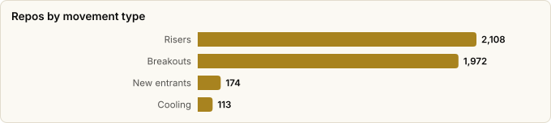

# Trending Now — What's Actually Moving in Your Stars

> Derived from **kaiser-data**'s 2,896 starred repos (snapshot `2026-11-16T14:38:50.632Z`), cross-referenced with the repo-similarity graph (2,896 nodes / 9,609 edges, 48 communities).
>
> Generated 2026-11-16 by `scripts/reports/trending_now.py` (regenerate any time — no API cost).

## Executive summary

- **This is the only report here that measures *change* rather than describing a landscape.** Every other report curates a taxonomy and renders it against the current vintage; this one diffs archived snapshots to show what actually moved.
- **Window**: `2026-11-09` → `2026-11-16` (**7 days**), covering the **2,722 repos** present in both snapshots. Long-run comparisons use `2026-06-11` → `2026-11-16` (**158 days**).
- **2,108 repos gained stars** in the recent window, adding **358,123★** between them.
- **174 repos are new to the dataset** since the last refresh — newly starred, so they have no baseline to diff and are listed separately.
- **Measured, not estimated.** `classified.json` carries a `momentum` field, but it is a lifetime-stars/day proxy (its own source comment calls it "a serviceable proxy"). Everything below is observed snapshot-to-snapshot movement over a known number of days.

## How to read this

| Board | Question it answers | Bias to watch |
|---|---|---|
| **Fastest risers** | What gained the most stars outright? | Favours repos that are already huge — a 1% move on 100k stars beats a doubling at 500. |
| **Breakouts** | What grew fastest *relative to its size*? | Favours small repos; floored at 300★ baseline so noise doesn't win. |
| **Sustained climbers** | What has compounded over the long window? | Smooths out one-off spikes (a HN front page, a launch). |
| **New entrants** | What did you just start following? | Not growth at all — these have no baseline. |
| **Cooling off** | What is still growing, but much slower than it was? | Deceleration usually means a launch spike ending, not a project dying. |

## Fastest risers — absolute (2026-11-09 → 2026-11-16, 7d)

Raw star gain over the window. `Stars/day` normalizes for window length so this stays comparable across refreshes of different spacing.

| # | Repo | Gain | Stars/day | Stars now | Lang | Lifecycle | Activity |
|---|---|---|---|---|---|---|---|
| 1 | [morluto/rea](https://github.com/morluto/rea) | **+17,579** | 2511.3 | 463,252 | TypeScript | Hot | very active |
| 2 | [mattpocock/skills](https://github.com/mattpocock/skills) | **+6,435** | 919.3 | 325,658 | Shell | Hot | very active |
| 3 | [stablyai/orca](https://github.com/stablyai/orca) | **+6,395** | 913.6 | 126,400 | TypeScript | Hot | very active |
| 4 | [cloudflare/security-audit-skill](https://github.com/cloudflare/security-audit-skill) | **+6,049** | 864.1 | 73,592 | JavaScript | Declining | slowing |
| 5 | [debpalash/VoiceStudio](https://github.com/debpalash/VoiceStudio) | **+6,020** | 860.0 | 111,708 | Python | Hot | very active |
| 6 | [anthropics/skills](https://github.com/anthropics/skills) | **+5,378** | 768.3 | 195,720 | Python | Mature | active |
| 7 | [deepseek-ai/deepseek-harness](https://github.com/deepseek-ai/deepseek-harness) | **+4,958** | 708.3 | 282,172 | TypeScript | Hot | very active |
| 8 | [h4ckf0r0day/obscura](https://github.com/h4ckf0r0day/obscura) | **+4,613** | 659.0 | 35,814 | Rust | Hot | very active |
| 9 | [DietrichGebert/ponytail](https://github.com/DietrichGebert/ponytail) | **+4,547** | 649.6 | 191,875 | JavaScript | Hot | very active |
| 10 | [pbakaus/impeccable](https://github.com/pbakaus/impeccable) | **+4,543** | 649.0 | 111,127 | Rust | Mature | very active |
| 11 | [Nutlope/hallmark](https://github.com/Nutlope/hallmark) | **+4,399** | 628.4 | 55,850 | CSS | Hot | very active |
| 12 | [affaan-m/ECC](https://github.com/affaan-m/ECC) | **+4,264** | 609.1 | 304,244 | JavaScript | Hot | very active |
| 13 | [Leonxlnx/taste-skill](https://github.com/Leonxlnx/taste-skill) | **+4,255** | 607.9 | 116,584 | JavaScript | Hot | very active |
| 14 | [google/elephant-goldfish-model](https://github.com/google/elephant-goldfish-model) | **+4,174** | 596.3 | 20,136 | Python | Hot | very active |
| 15 | [Graphify-Labs/graphify](https://github.com/Graphify-Labs/graphify) | **+3,933** | 561.9 | 148,781 | Python | Hot | very active |
| 16 | [addyosmani/agent-skills](https://github.com/addyosmani/agent-skills) | **+3,800** | 542.9 | 118,171 | JavaScript | Hot | very active |
| 17 | [tashfeenahmed/freellmapi](https://github.com/tashfeenahmed/freellmapi) | **+3,694** | 527.7 | 53,216 | TypeScript | Hot | very active |
| 18 | [vercel-labs/agent-browser](https://github.com/vercel-labs/agent-browser) | **+3,684** | 526.3 | 51,869 | Rust | Hot | very active |
| 19 | [heygen-com/hyperframes](https://github.com/heygen-com/hyperframes) | **+3,589** | 512.7 | 85,034 | TypeScript | Hot | very active |
| 20 | [sindresorhus/awesome](https://github.com/sindresorhus/awesome) | **+3,550** | 507.1 | 537,791 | — | Mature | slowing |

## Breakouts — fastest relative growth (≥300★ baseline)

Percent growth over the same 7-day window. The baseline floor keeps small-number noise off the board — a repo going 8★ → 20★ is not a trend.

| # | Repo | Growth | Gain | Stars now | What it is |
|---|---|---|---|---|---|
| 1 | [Continuum-AI-Corp/OrcaReplay](https://github.com/Continuum-AI-Corp/OrcaReplay) | **+81%** | +368 | 820 | OrcaReplay — Time travel for AI agents. Record, replay, fork, and debug any agent run wi… |
| 2 | [strands-labs/strands-decider](https://github.com/strands-labs/strands-decider) | **+56%** | +432 | 1,201 | A small, fast decision model, or system one model, for agentic workflows. Pick between o… |
| 3 | [haydenschmitty/floorplan](https://github.com/haydenschmitty/floorplan) | **+39%** | +1,295 | 4,598 | See how your app actually fits together. An interactive, plain-English map of your codeb… |
| 4 | [Jakeschincariol/day-trader-skill](https://github.com/Jakeschincariol/day-trader-skill) | **+28%** | +1,790 | 8,094 | 11 Claude skills for day trading: scan thousands of charts, track breaking news, time ev… |
| 5 | [google/elephant-goldfish-model](https://github.com/google/elephant-goldfish-model) | **+26%** | +4,174 | 20,136 | Open-source plugin for designing and reviewing software with agents |
| 6 | [adewaskar/jarvis](https://github.com/adewaskar/jarvis) | **+26%** | +192 | 934 | J.A.R.V.I.S for automating your daily tasks using Claude Code |
| 7 | [backnotprop/plannotator](https://github.com/backnotprop/plannotator) | **+24%** | +2,350 | 12,283 | The workspace to stay in the loop and on top of agents - shape, decide, plan, annotate, … |
| 8 | [NVIDIA/auto-ontology](https://github.com/NVIDIA/auto-ontology) | **+22%** | +2,374 | 13,199 | Auto Ontology is a Python framework for building semantic, graph-based reasoning layers … |
| 9 | [CopilotKit/OpenBot](https://github.com/CopilotKit/OpenBot) | **+19%** | +1,991 | 12,528 | Open-source AI coworkers that each get a computer of their own: a browser, files and too… |
| 10 | [udhaykumarbala/cleanyourtv-app](https://github.com/udhaykumarbala/cleanyourtv-app) | **+19%** | +347 | 2,222 | A community-built phone app for Clean Your TV: clean up an Android TV from your phone. N… |
| 11 | [NiazMorshed2007/reanimate](https://github.com/NiazMorshed2007/reanimate) | **+16%** | +241 | 1,711 | A Claude Code skill that reverse-engineers any animation frame by frame, then proves the… |
| 12 | [punkpeye/awesome-remote-mcp-servers](https://github.com/punkpeye/awesome-remote-mcp-servers) | **+16%** | +457 | 3,308 | A collection of remote MCP servers. |
| 13 | [WordPress/openverse](https://github.com/WordPress/openverse) | **+16%** | +89 | 660 | Openverse is a search engine for openly-licensed media. This monorepo includes all appli… |
| 14 | [blogminhquy/javis-os](https://github.com/blogminhquy/javis-os) | **+15%** | +107 | 828 | — |
| 15 | [Leonxlnx/earshot](https://github.com/Leonxlnx/earshot) | **+15%** | +640 | 4,968 | Ears for coding agents: let AI hear, review and make sound. CPU-only, open source. |
| 16 | [h4ckf0r0day/obscura](https://github.com/h4ckf0r0day/obscura) | **+15%** | +4,613 | 35,814 | The headless browser for AI agents and web scraping |
| 17 | [serenedb/serenedb](https://github.com/serenedb/serenedb) | **+15%** | +141 | 1,109 | The First Real-Time Search Analytics Database |
| 18 | [mutonby/openshorts](https://github.com/mutonby/openshorts) | **+13%** | +1,011 | 8,599 | Open source AI clip generator: turns long videos into viral 9:16 shorts with AI moment d… |
| 19 | [open-jarvis/OpenJarvis](https://github.com/open-jarvis/OpenJarvis) | **+12%** | +1,753 | 15,802 | Personal AI, On Personal Devices |
| 20 | [HeyPuter/everything](https://github.com/HeyPuter/everything) | **+10%** | +744 | 8,505 | We're rebuilding and open-sourcing the world’s software from scratch. |

## Sustained climbers — long run (2026-06-11 → 2026-11-16, 158d)

Averaged over the full snapshot history, so a single viral week doesn't dominate. Repos high here *and* in the recent board are compounding, not spiking.

| # | Repo | Stars/day | Total gain | Stars now | Lang | Health |
|---|---|---|---|---|---|---|
| 1 | [obra/superpowers](https://github.com/obra/superpowers) | **592.6** | +93,635 | 318,369 | Shell | 63 |
| 2 | [affaan-m/ECC](https://github.com/affaan-m/ECC) | **574.7** | +90,810 | 304,244 | JavaScript | 79 |
| 3 | [NousResearch/hermes-agent](https://github.com/NousResearch/hermes-agent) | **461.2** | +72,876 | 263,809 | Python | 80 |
| 4 | [firecrawl/firecrawl](https://github.com/firecrawl/firecrawl) | **447.5** | +70,707 | 202,234 | TypeScript | 89 |
| 5 | [sindresorhus/awesome](https://github.com/sindresorhus/awesome) | **398.2** | +62,910 | 537,791 | — | 47 |
| 6 | [earendil-works/pi](https://github.com/earendil-works/pi) | **383.1** | +60,536 | 122,314 | TypeScript | 80 |
| 7 | [multica-ai/andrej-karpathy-skills](https://github.com/multica-ai/andrej-karpathy-skills) | **380.8** | +60,160 | 233,640 | — | 17 |
| 8 | [nextlevelbuilder/ui-ux-pro-max-skill](https://github.com/nextlevelbuilder/ui-ux-pro-max-skill) | **378.6** | +59,815 | 150,253 | Python | 96 |
| 9 | [public-apis/public-apis](https://github.com/public-apis/public-apis) | **371.2** | +58,643 | 499,504 | Python | 64 |
| 10 | [heygen-com/hyperframes](https://github.com/heygen-com/hyperframes) | **368.5** | +58,221 | 85,034 | TypeScript | 83 |
| 11 | [harry0703/MoneyPrinterTurbo](https://github.com/harry0703/MoneyPrinterTurbo) | **366.2** | +57,857 | 143,954 | Python | 90 |
| 12 | [msitarzewski/agency-agents](https://github.com/msitarzewski/agency-agents) | **362.4** | +57,262 | 168,715 | Shell | 62 |
| 13 | [farion1231/cc-switch](https://github.com/farion1231/cc-switch) | **357.0** | +56,404 | 154,883 | Rust | 79 |
| 14 | [anomalyco/opencode](https://github.com/anomalyco/opencode) | **341.9** | +54,021 | 227,221 | TypeScript | 84 |
| 15 | [usestrix/strix](https://github.com/usestrix/strix) | **316.2** | +49,960 | 75,906 | Python | 80 |
| 16 | [JuliusBrussee/caveman](https://github.com/JuliusBrussee/caveman) | **311.0** | +49,134 | 120,649 | Go | 79 |
| 17 | [codecrafters-io/build-your-own-x](https://github.com/codecrafters-io/build-your-own-x) | **307.8** | +48,629 | 563,058 | Markdown | 44 |
| 18 | [anthropics/skills](https://github.com/anthropics/skills) | **292.6** | +46,233 | 195,720 | Python | 50 |
| 19 | [DeusData/codebase-memory-mcp](https://github.com/DeusData/codebase-memory-mcp) | **287.4** | +45,403 | 48,720 | C | 76 |
| 20 | [openai/codex](https://github.com/openai/codex) | **285.1** | +45,044 | 135,502 | Rust | 93 |

## Emerging themes

The boards above are computed; this section is interpretation. Each theme groups movers that are rising for the same underlying reason.

### Skills as the packaging format for agent behaviour

_The single loudest signal in this dataset. A year ago you configured an agent with a prompt; now behaviour ships as a versioned, installable *skill* bundle — and the repos distributing those bundles are growing faster than the agents that consume them. Note what this implies: the moat is moving from the model to the instruction layer._

- **[anthropics/skills](https://github.com/anthropics/skills)** · 195,720★ · +5,378★ in 7d  
  Public repository for Agent Skills
- **[DietrichGebert/ponytail](https://github.com/DietrichGebert/ponytail)** · 191,875★ · +4,547★ in 7d  
  Makes your AI agent think like the laziest senior dev in the room. The best code is the code you never wrote.
- **[affaan-m/ECC](https://github.com/affaan-m/ECC)** · 304,244★ · +4,264★ in 7d  
  The agent harness performance optimization system. Skills, instincts, memory, security, and research-first development for Claude Code, Codex, Opencode, Cursor and beyond.
- **[obra/superpowers](https://github.com/obra/superpowers)** · 318,369★ · +3,481★ in 7d  
  An agentic skills framework & software development methodology that works.
- **[nextlevelbuilder/ui-ux-pro-max-skill](https://github.com/nextlevelbuilder/ui-ux-pro-max-skill)** · 150,253★ · +3,046★ in 7d  
  An AI skill that provides design intelligence for building professional UI/UX across multiple platforms.
- **[multica-ai/andrej-karpathy-skills](https://github.com/multica-ai/andrej-karpathy-skills)** · 233,640★ · +2,453★ in 7d  
  A single CLAUDE.md file to improve Claude Code behavior, derived from Andrej Karpathy's observations on LLM coding pitfalls.
- **[msitarzewski/agency-agents](https://github.com/msitarzewski/agency-agents)** · 168,715★ · +1,276★ in 7d  
  A complete AI agency at your fingertips - From frontend wizards to Reddit community ninjas, from whimsy injectors to reality checkers. Each agent is a specialized expert with personality, processes, and proven deliverables.
- **[garrytan/gstack](https://github.com/garrytan/gstack)** · 141,767★ · +870★ in 7d  
  Use Garry Tan's exact Claude Code setup: 23 opinionated tools that serve as CEO, Designer, Eng Manager, Release Manager, Doc Engineer, and QA
- **[ayghri/i-have-adhd](https://github.com/ayghri/i-have-adhd)** · 61,360★ · +764★ in 7d  
  A skill to stop your coding agent from burying the answer. ADHD-friendly output.
- **[hesreallyhim/awesome-claude-code](https://github.com/hesreallyhim/awesome-claude-code)** · 58,130★ · +538★ in 7d  
  A hand-picked collection of the finest of resources for the most awesome of agents, Claude Code, the undisputed champion of coding companions, from the unstoppable team at Anthropic PBC (no affiliation). A delectable showcase of top tier skills, ambidextrous agents, scintillating status lines, top notch developer tooling, and also we have plugins
- **[shanraisshan/claude-code-best-practice](https://github.com/shanraisshan/claude-code-best-practice)** · 69,105★ · +230★ in 7d  
  from vibe coding to agentic engineering - practice makes claude perfect

### Giving agents a memory of the codebase

_Retrieval over a codebase is being replaced by *pre-indexed structure* — graphs and persistent stores an agent can consult instead of re-reading files every session. This is the same insight the graph in this repo is built on, and it is now one of the fastest-moving categories in your stars._

- **[Graphify-Labs/graphify](https://github.com/Graphify-Labs/graphify)** · 148,781★ · +3,933★ in 7d  
  Turn any codebase, with its docs, SQL schemas, configs, and PDFs, into a queryable knowledge graph. A /graphify skill for Claude Code, Cursor, Codex, and Gemini CLI: local deterministic AST parsing, every edge explained, no vector store.
- **[thedotmack/claude-mem](https://github.com/thedotmack/claude-mem)** · 117,552★ · +2,325★ in 7d  
  Persistent Context Across Sessions for Every Agent –  Captures everything your agent does during sessions, compresses it with AI, and injects relevant context back into future sessions. Works with Claude Code, OpenClaw, Codex, Gemini, Hermes, Copilot, OpenCode + More
- **[Egonex-AI/Understand-Anything](https://github.com/Egonex-AI/Understand-Anything)** · 92,816★ · +1,109★ in 7d  
  Graphs that teach > graphs that impress. Turn any code into an interactive knowledge graph you can explore, search, and ask questions about. Works with Claude Code, Codex, Cursor, Copilot, Gemini CLI, and more.
- **[colbymchenry/codegraph](https://github.com/colbymchenry/codegraph)** · 77,730★ · +563★ in 7d  
  Pre-indexed code knowledge graph, auto syncs on code changes, for Claude Code, Codex, Gemini, Cursor, OpenCode, AntiGravity, Kiro, CoPilot, and Hermes Agent — fewer tokens, fewer tool calls, 100% local
- **[DeusData/codebase-memory-mcp](https://github.com/DeusData/codebase-memory-mcp)** · 48,720★ · +319★ in 7d  
  Local code intelligence for developers and AI agents. Connect code, docs and infrastructure in a persistent graph, with CBM Lens, MCP tools, agent integrations and change-aware test selection.
- **[TencentCloud/TencentDB-Agent-Memory](https://github.com/TencentCloud/TencentDB-Agent-Memory)** · 30,937★ · +251★ in 7d  
  TencentDB Agent Memory is a team-level memory hub for AI Agents — turning conversations, docs, and code into four reusable memory assets (Chat Memory, Skill, LLM-Wiki, Code-Graph) that are governed, shared, and equipped across agents and frameworks.
- **[topoteretes/cognee](https://github.com/topoteretes/cognee)** · 33,347★ · +170★ in 7d  
  Cognee is the open-source AI memory platform for agents. Give your AI agents persistent long-term memory with small models for free
- **[langchain-ai/openwiki](https://github.com/langchain-ai/openwiki)** · 17,973★ · +134★ in 7d  
  OpenWiki is a CLI that writes and maintains agent documentation for your codebase.
- **[semantica-agi/semantica](https://github.com/semantica-agi/semantica)** · 14,627★ · +134★ in 7d  
  Graph-Native Infrastructure for Context and Accountable AI Systems
- **[repowise-dev/repowise](https://github.com/repowise-dev/repowise)** · 8,151★ · +56★ in 7d  
  Codebase intelligence for AI and humans: code health scores, auto-generated docs, git analytics, dead code detection, and architectural decisions via MCP.
- **[zilliztech/claude-context](https://github.com/zilliztech/claude-context)** · 12,694★ · +16★ in 7d  
  Code search MCP for Claude Code. Make entire codebase the context for any coding agent.

### Frontier models on hardware you already own

_The counter-current to everything above: instead of making API calls cheaper, remove them. Big mixture-of-experts models are being squeezed onto consumer machines, and the repos doing it are among the fastest relative movers in the dataset._

- **[JustVugg/colibri](https://github.com/JustVugg/colibri)** · 51,505★ · +2,236★ in 7d  
  A hierarchical inference engine for frontier MoE models: hot experts on the GPU (CUDA, Vulkan), warm ones in RAM, cold ones streamed from NVMe. Written in C, runs on the hardware you already own.
- **[ggml-org/llama.cpp](https://github.com/ggml-org/llama.cpp)** · 135,269★ · +1,452★ in 7d  
  LLM inference in C/C++
- **[lyogavin/airllm](https://github.com/lyogavin/airllm)** · 42,492★ · +444★ in 7d  
  AirLLM 2.8T LLM inference with single 4GB GPU
- **[Mesh-LLM/mesh-llm](https://github.com/Mesh-LLM/mesh-llm)** · 4,137★ · +140★ in 7d  
  Distributed AI/LLM for the people. Share compute privately or publicly to power your agents and chat.
- **[microsoft/foundry-local](https://github.com/microsoft/foundry-local)** · 2,654★ · +9★ in 7d  
  —

### Token economics became a product category

_Context windows got bigger and people started paying for them. These repos exist purely to make agents cheaper to run — compressing tool output, trimming prompts, proxying calls. That a compression layer can add tens of thousands of stars in weeks says the cost pressure is real, not theoretical._

- **[Alishahryar1/free-claude-code](https://github.com/Alishahryar1/free-claude-code)** · 70,738★ · +3,222★ in 7d  
  Use Claude Code, Codex, Antigravity, VSCode, Pi, and OpenCode (and 6 other harnesses) for free (1.3B+ free tokens) from your terminal, app, IDE, or phone, and now from the browser with native browser sessions (multi-harness + multi-model) like OpenClaw (voice supported + ToS friendly)
- **[JustVugg/colibri](https://github.com/JustVugg/colibri)** · 51,505★ · +2,236★ in 7d  
  A hierarchical inference engine for frontier MoE models: hot experts on the GPU (CUDA, Vulkan), warm ones in RAM, cold ones streamed from NVMe. Written in C, runs on the hardware you already own.
- **[JuliusBrussee/caveman](https://github.com/JuliusBrussee/caveman)** · 120,649★ · +2,118★ in 7d  
  🪨 why use many token when few token do trick. Viral skill + proxy for coding agents that cuts 65% of tokens by talking like a caveman.
- **[rtk-ai/rtk](https://github.com/rtk-ai/rtk)** · 86,729★ · +748★ in 7d  
  CLI proxy that reduces LLM token consumption by 60-90% on common dev commands. Single Rust binary, zero dependencies
- **[headroomlabs-ai/headroom](https://github.com/headroomlabs-ai/headroom)** · 79,804★ · +593★ in 7d  
  Compress tool outputs, logs, files, and RAG chunks before they reach the LLM. 20% fewer tokens for coding agents, 60-95% fewer tokens for JSON, same answers. Library, proxy, MCP server.

### The coding-agent harness field is still splitting, not consolidating

_Terminal coding agents keep multiplying rather than converging on a winner, and a second layer has appeared above them: switchers, meta-harnesses, and orchestrators whose job is to manage the agents themselves._

- **[farion1231/cc-switch](https://github.com/farion1231/cc-switch)** · 154,883★ · +1,870★ in 7d  
  A cross-platform desktop All-in-One assistant for Claude Code, Codex, OpenCode,DeepSeek Harness and more. Only official website: ccswitch.io
- **[NousResearch/hermes-agent](https://github.com/NousResearch/hermes-agent)** · 263,809★ · +1,843★ in 7d  
  The agent that grows with you
- **[paperclipai/paperclip](https://github.com/paperclipai/paperclip)** · 114,265★ · +1,755★ in 7d  
  The open-source app everyone uses to manage agents at work
- **[anomalyco/opencode](https://github.com/anomalyco/opencode)** · 227,221★ · +1,546★ in 7d  
  The open source coding agent.
- **[earendil-works/pi](https://github.com/earendil-works/pi)** · 122,314★ · +1,295★ in 7d  
  AI agent toolkit: unified LLM API, agent loop, TUI, coding agent CLI
- **[openai/codex](https://github.com/openai/codex)** · 135,502★ · +1,255★ in 7d  
  Lightweight coding agent that runs in your terminal
- **[multica-ai/multica](https://github.com/multica-ai/multica)** · 56,330★ · +926★ in 7d  
  Make humans and AI agents work as one team — open-source and self-hostable.
- **[anthropics/claude-code](https://github.com/anthropics/claude-code)** · 155,871★ · +792★ in 7d  
  Claude Code is an agentic coding tool that lives in your terminal, understands your codebase, and helps you code faster by executing routine tasks, explaining complex code, and handling git workflows - all through natural language commands.
- **[OpenHands/OpenHands](https://github.com/OpenHands/OpenHands)** · 93,582★ · +552★ in 7d  
  🙌 OpenHands: AI-Driven Development
- **[getpaseo/paseo](https://github.com/getpaseo/paseo)** · 24,167★ · +550★ in 7d  
  Orchestrate multiple coding agents from desktop and mobile
- **[ruvnet/ruflo](https://github.com/ruvnet/ruflo)** · 81,856★ · +530★ in 7d  
  🌊 The original agent harness. Deploy intelligent multi-player swarms, coordinate autonomous workflows, and build conversational AI systems. Features adaptive memory, self-learning intelligence, federation, vector RAG integration, and native Claude Code / Codex / Hermes and many more Integrated
- **[bytedance/deer-flow](https://github.com/bytedance/deer-flow)** · 85,395★ · +212★ in 7d  
  An open-source long-horizon SuperAgent harness that researches, codes, and creates. With the help of sandboxes, memories, tools, skill, subagents and message gateway, it handles different levels of tasks that could take minutes to hours.
- **[1jehuang/jcode](https://github.com/1jehuang/jcode)** · 21,811★ · +174★ in 7d  
  High performance coding agent harness written in Rust, built for heavy multi-agent dev workflows
- **[code-yeongyu/oh-my-openagent](https://github.com/code-yeongyu/oh-my-openagent)** · 70,942★ · +144★ in 7d  
  OmO: Just type "mass ulw" keyword with your prompt. Now you are the master of graph engineering.
- **[vercel/eve](https://github.com/vercel/eve)** · 5,918★ · +88★ in 7d  
  The Open Framework for Building Agents

### Agents are leaving the terminal for specific jobs

_The generalist assistant is being joined by vertical agents pointed at one domain — pentesting, trading, tutoring, job hunting, video. These grow on usefulness to a specific audience rather than on developer-tool hype._

- **[heygen-com/hyperframes](https://github.com/heygen-com/hyperframes)** · 85,034★ · +3,589★ in 7d  
  Write HTML. Render video. Built for agents.
- **[HKUDS/DeepTutor](https://github.com/HKUDS/DeepTutor)** · 59,687★ · +2,230★ in 7d  
  DeepTutor: Lifelong Personalized Tutoring. https://deeptutor.info/.
- **[career-ops-hq/career-ops](https://github.com/career-ops-hq/career-ops)** · 82,977★ · +1,606★ in 7d  
  Open-source AI job search agent and job finder: scan job boards, score each job 1-5 against your CV before you apply, tailor an ATS-friendly resume and cover letter, get interview prep and an application tracker. It helps you fill in each application; you press Submit. Runs locally in Codex, OpenCode and other AI CLIs, or as a Claude Code plugin.
- **[usestrix/strix](https://github.com/usestrix/strix)** · 75,906★ · +1,309★ in 7d  
  Open-source AI penetration testing tool to find and fix your app’s vulnerabilities.
- **[TauricResearch/TradingAgents](https://github.com/TauricResearch/TradingAgents)** · 122,806★ · +1,299★ in 7d  
  TradingAgents: Multi-Agents LLM Financial Trading Framework
- **[browser-use/browser-use](https://github.com/browser-use/browser-use)** · 121,193★ · +777★ in 7d  
  Open-source Python library for AI browser agents, plus Browser Use Cloud: stealth browsers and a hosted agent API.
- **[jamiepine/voicebox](https://github.com/jamiepine/voicebox)** · 60,748★ · +509★ in 7d  
  The open-source AI voice studio. Clone, dictate, create.
- **[HKUDS/Vibe-Trading](https://github.com/HKUDS/Vibe-Trading)** · 38,367★ · +419★ in 7d  
  "Vibe-Trading: Your Personal Trading Agent"
- **[Canner/WrenAI](https://github.com/Canner/WrenAI)** · 18,300★ · +185★ in 7d  
  GenBI (Generative BI) for AI agents, an open-source, governed text-to-SQL through an open context layer that turns natural-language questions into trusted dashboards, charts, and SQL across 20+ data sources, such as BigQuery, Snowflake, PostgreSQL, ClickHouse, Amazon Redshift, Databricks and more.
- **[Zackriya-Solutions/meetily](https://github.com/Zackriya-Solutions/meetily)** · 32,739★ · +183★ in 7d  
  Privacy-first AI meeting note taker for Windows, macOS and Linux. Free, open source (MIT). On-device Whisper/Parakeet transcription and speaker diarization, no meeting bot. Open-source alternative to Granola, Otter and Fireflies. https://meetily.ai

### Design and spec as agent-readable artifacts

_If an agent writes the code, the leverage moves upstream to the spec and the design system. These repos turn intent into something an agent can consume directly._

- **[nextlevelbuilder/ui-ux-pro-max-skill](https://github.com/nextlevelbuilder/ui-ux-pro-max-skill)** · 150,253★ · +3,046★ in 7d  
  An AI skill that provides design intelligence for building professional UI/UX across multiple platforms.
- **[VoltAgent/awesome-design-md](https://github.com/VoltAgent/awesome-design-md)** · 127,771★ · +1,508★ in 7d  
  A collection of DESIGN.md files analysis by popular brand design systems. Drop one into your project and let coding agents generate a matching UI.
- **[github/spec-kit](https://github.com/github/spec-kit)** · 150,046★ · +1,131★ in 7d  
  💫 Toolkit to help you get started with SDD or any other process!
- **[nexu-io/open-design](https://github.com/nexu-io/open-design)** · 107,878★ · +1,116★ in 7d  
  The 1st Collaborative AI Design Agent Workspace. Local-first and open source. Create motion, prototypes, websites, apps, dashboards, presentations, images, and videos with your team and AI agents. Share work, exchange feedback, and iterate together in one workspace.

## New entrants — newly starred since the last refresh

These joined the dataset during this window, so they have no baseline to diff. They are what *you* just found interesting, which is its own kind of trend signal.

| Repo | Stars | Lang | Lifecycle | What it is |
|---|---|---|---|---|
| [golang/go](https://github.com/golang/go) | 139,908 | Go | Classic | The Go programming language |
| [kubernetes/kubernetes](https://github.com/kubernetes/kubernetes) | 129,087 | Go | Classic | Production-Grade Container Scheduling and Management |
| [tt-a1i/archify](https://github.com/tt-a1i/archify) | 97,043 | JavaScript | Rising | Turn any idea, plan, or codebase into a beautiful interactive diagram. An agent skil… |
| [moby/moby](https://github.com/moby/moby) | 72,271 | Go | Classic | The Moby Project - a collaborative project for the container ecosystem to assemble c… |
| [traefik/traefik](https://github.com/traefik/traefik) | 65,567 | Go | Classic | The Cloud Native Application Proxy |
| [emilkowalski/skills](https://github.com/emilkowalski/skills) | 57,353 | Markdown | Rising | Skills for Designers and Engineers. |
| [obsidianmd/obsidian-skills](https://github.com/obsidianmd/obsidian-skills) | 52,904 | Shell | Hot | Agent skills for Obsidian. Teach your agent to use Obsidian CLI and open formats inc… |
| [hashicorp/terraform](https://github.com/hashicorp/terraform) | 50,253 | Go | Classic | Terraform enables you to safely and predictably create, change, and improve infrastr… |
| [shiyu-coder/Kronos](https://github.com/shiyu-coder/Kronos) | 47,884 | Python | Declining | Kronos: A Foundation Model for the Language of Financial Markets |
| [saadeghi/daisyui](https://github.com/saadeghi/daisyui) | 42,854 | JavaScript | Classic | 🌼 🌼 🌼 🌼 🌼  The most popular, free and open-source Tailwind CSS component library |
| [goabstract/Awesome-Design-Tools](https://github.com/goabstract/Awesome-Design-Tools) | 41,917 | JavaScript | Abandoned | The best design tools and plugins for everything 👉 |
| [vuetifyjs/vuetify](https://github.com/vuetifyjs/vuetify) | 41,040 | TypeScript | Classic | 🐉 Vue Component Framework |
| [hyprwm/Hyprland](https://github.com/hyprwm/Hyprland) | 40,672 | C++ | Classic | Hyprland is an independent, highly customizable, dynamic tiling Wayland compositor t… |
| [typeorm/typeorm](https://github.com/typeorm/typeorm) | 36,673 | TypeScript | Classic | TypeScript & JavaScript ORM for Node.js — supports PostgreSQL, MySQL, MariaDB, SQLit… |
| [raysan5/raylib](https://github.com/raysan5/raylib) | 35,697 | C | Classic | A simple and easy-to-use library to enjoy videogames programming |
| [google-research/timesfm](https://github.com/google-research/timesfm) | 35,600 | Python | Mature | TimesFM (Time Series Foundation Model) is a pretrained time-series foundation model … |
| [storytold/craft-anything](https://github.com/storytold/craft-anything) | 34,416 | Rust | Hot | Craft Anything: understand how any software works, and craft your own. |
| [projectdiscovery/nuclei](https://github.com/projectdiscovery/nuclei) | 32,977 | Go | Classic | Nuclei is a fast, customizable vulnerability scanner powered by the global security … |
| [helm/helm](https://github.com/helm/helm) | 30,431 | Go | Classic | The Kubernetes Package Manager |
| [AgriciDaniel/claude-seo](https://github.com/AgriciDaniel/claude-seo) | 29,896 | Python | Hot | Universal SEO skill for Claude Code. 26 sub-skills + 19 sub-agents covering technica… |
| [trufflesecurity/trufflehog](https://github.com/trufflesecurity/trufflehog) | 29,399 | Go | Classic | Find, verify, and analyze leaked credentials |
| [grafana/loki](https://github.com/grafana/loki) | 29,166 | Go | Classic | Like Prometheus, but for logs. |
| [charmbracelet/glow](https://github.com/charmbracelet/glow) | 28,058 | Go | Mature | Render markdown on the CLI, with pizzazz! 💅🏻 |
| [cloudflare/pingora](https://github.com/cloudflare/pingora) | 27,915 | Rust | Classic | A library for building fast, reliable and evolvable network services. |
| [lucide-icons/lucide](https://github.com/lucide-icons/lucide) | 25,791 | TypeScript | Classic | Beautiful & consistent icon toolkit made by the community. Lucide is an open-source … |
| [argoproj/argo-cd](https://github.com/argoproj/argo-cd) | 24,622 | Go | Classic | Declarative Continuous Deployment for Kubernetes |
| [charmbracelet/gum](https://github.com/charmbracelet/gum) | 24,607 | Go | Mature | A tool for glamorous shell scripts 🎀 |
| [iview/iview](https://github.com/iview/iview) | 23,743 | Vue | Abandoned | A high quality UI Toolkit built on Vue.js 2.0 |
| [jaegertracing/jaeger](https://github.com/jaegertracing/jaeger) | 23,416 | Go | Classic | CNCF Jaeger, a Distributed Tracing Platform |
| [ratatui/ratatui](https://github.com/ratatui/ratatui) | 23,323 | Rust | Classic | A Rust crate for cooking up terminal user interfaces (TUIs) 👨‍🍳🐀 https://ratatui.rs |
| [go-chi/chi](https://github.com/go-chi/chi) | 23,110 | Go | Classic | lightweight, idiomatic and composable router for building Go HTTP services |
| [microsoft/unilm](https://github.com/microsoft/unilm) | 22,242 | Python | Mature | Large-scale Self-supervised Pre-training Across Tasks, Languages, and Modalities |
| [vueComponent/ant-design-vue](https://github.com/vueComponent/ant-design-vue) | 21,716 | Vue | Mature | 🌈  An enterprise-class UI components based on Ant Design and Vue. 🐜 |
| [react-dnd/react-dnd](https://github.com/react-dnd/react-dnd) | 21,624 | TypeScript | Abandoned | Drag and Drop for React |
| [charmbracelet/vhs](https://github.com/charmbracelet/vhs) | 21,325 | Go | Mature | Your CLI home video recorder 📼 |
| [nats-io/nats-server](https://github.com/nats-io/nats-server) | 21,047 | Go | Classic | High-Performance server for NATS.io, the cloud and edge native messaging system. |
| [ppy/osu](https://github.com/ppy/osu) | 19,453 | C# | Classic | rhythm is just a *click* away! |
| [sqlc-dev/sqlc](https://github.com/sqlc-dev/sqlc) | 18,460 | Go | Classic | Generate type-safe code from SQL |
| [semgrep/semgrep](https://github.com/semgrep/semgrep) | 17,722 | C | Classic | Lightweight static analysis for many languages. Find bug variants with patterns that… |
| [tigerbeetle/tigerbeetle](https://github.com/tigerbeetle/tigerbeetle) | 17,390 | Zig | Classic | The financial transactions database designed for mission critical safety and perform… |
| _…and 134 more_ | | | | |

## Cooling off

Deceleration, not decline. These averaged ≥1★/day across the 158-day long window but are now running below 40% of that rate. Most are still gaining — just far more slowly than they were, which is usually the tail of a launch spike rather than a problem.

| Repo | Long-run ★/day | Recent ★/day | Now at | Last push | Lifecycle |
|---|---|---|---|---|---|
| [ultraworkers/claw-code](https://github.com/ultraworkers/claw-code) | 7.1 | -22.9 | **-320%** of prior pace | 6d ago | Hot |
| [microsoft/TypeScript](https://github.com/microsoft/TypeScript) | 16.8 | -4.4 | **-26%** of prior pace | 0d ago | Classic |
| [haotian-liu/LLaVA](https://github.com/haotian-liu/LLaVA) | 1.3 | -0.1 | **-11%** of prior pace | 2.3y ago | Abandoned |
| [HKUDS/ClawWork](https://github.com/HKUDS/ClawWork) | 2.3 | -0.1 | **-6%** of prior pace | 8mo ago | Declining |
| [RightNow-AI/picolm](https://github.com/RightNow-AI/picolm) | 3.6 | -0.1 | **-4%** of prior pace | 8mo ago | Declining |
| [hexo-ai/sia](https://github.com/hexo-ai/sia) | 6.0 | -0.1 | **-2%** of prior pace | 2mo ago | Mature |
| [https-deeplearning-ai/deeplearning-ai](https://github.com/https-deeplearning-ai/deeplearning-ai) | 1.1 | 0.0 | **0%** of prior pace | 5mo ago | Declining |
| [neuphonic/neutts](https://github.com/neuphonic/neutts) | 2.2 | 0.0 | **0%** of prior pace | 3mo ago | Declining |
| [JohnMwendwa/free-ai-resources](https://github.com/JohnMwendwa/free-ai-resources) | 1.1 | 0.0 | **0%** of prior pace | 1.5y ago | Abandoned |
| [FalkorDB/FalkorDB](https://github.com/FalkorDB/FalkorDB) | 37.7 | 1.3 | **3%** of prior pace | 0d ago | Classic |
| [RyanCodrai/turbovec](https://github.com/RyanCodrai/turbovec) | 40.8 | 1.6 | **4%** of prior pace | 1mo ago | Rising |
| [Infatoshi/cuda-course](https://github.com/Infatoshi/cuda-course) | 3.0 | 0.1 | **5%** of prior pace | 8mo ago | Declining |
| [dottxt-ai/outlines](https://github.com/dottxt-ai/outlines) | 13.0 | 0.7 | **5%** of prior pace | 1mo ago | Mature |
| [allenai/olmocr](https://github.com/allenai/olmocr) | 15.4 | 0.9 | **6%** of prior pace | 7mo ago | Declining |
| [Andyyyy64/whichllm](https://github.com/Andyyyy64/whichllm) | 14.6 | 1.0 | **7%** of prior pace | 2d ago | Hot |

## Graph analysis — where the movement clusters

**Community clustering.** The top 40 risers span **20 of the graph's 48 communities** — the more concentrated they are, the more this looks like one trend rather than broad drift.

- **Community 10** (9): `stablyai/orca`, `cloudflare/security-audit-skill`, `DietrichGebert/ponytail`, `affaan-m/ECC`, `Graphify-Labs/graphify`, `heygen-com/hyperframes`, `thedotmack/claude-mem`, `awesome-selfhosted/awesome-selfhosted`, `JuliusBrussee/caveman`
- **Community 11** (5): `Leonxlnx/taste-skill`, `addyosmani/agent-skills`, `sindresorhus/awesome`, `backnotprop/plannotator`, `public-apis/public-apis`
- **Community 40** (3): `h4ckf0r0day/obscura`, `D4Vinci/Scrapling`, `firecrawl/firecrawl`
- **Community 4** (2): `morluto/rea`, `Alishahryar1/free-claude-code`
- **Community 5** (2): `mattpocock/skills`, `anthropics/skills`
- **Community 12** (2): `debpalash/VoiceStudio`, `Gathin23/cleanyourtv`
- **Community 1** (2): `deepseek-ai/deepseek-harness`, `Niko1221/Strata`
- **Community 7** (2): `google/elephant-goldfish-model`, `JustVugg/colibri`
- **Community 31** (2): `nextlevelbuilder/ui-ux-pro-max-skill`, `cheaper-inference/OmniRoute`

**Direct links between risers** (similarity edges where both endpoints are climbing) — co-movement suggests a shared driver:

- `DietrichGebert/ponytail` ⇄ `affaan-m/ECC` (w=0.435) — topics: ai-agents, claude, claude-code, developer-tools
- `JuliusBrussee/caveman` ⇄ `affaan-m/ECC` (w=0.381) — topics: anthropic, claude, claude-code, llm; authors: dependabot[bot]
- `google/elephant-goldfish-model` ⇄ `DietrichGebert/ponytail` (w=0.368) — topics: agent-skills, ai-agents, claude-code, claude-code-plugin
- `Leonxlnx/taste-skill` ⇄ `addyosmani/agent-skills` (w=0.358) — topics: claude-code, codex, agent-skills, cursor
- `D4Vinci/Scrapling` ⇄ `firecrawl/firecrawl` (w=0.258) — topics: crawler, scraping, web-scraper, web-scraping
- `addyosmani/agent-skills` ⇄ `backnotprop/plannotator` (w=0.250) — topics: claude-code, skills, codex
- `morluto/rea` ⇄ `heygen-com/hyperframes` (w=0.217) — topics: mcp, claude-code, typescript, ai
- `public-apis/public-apis` ⇄ `sindresorhus/awesome` (w=0.125) — topics: resources, lists

**What the risers are written in** — language mix of the top 40 movers:

- **Python** — 12
- **TypeScript** — 10
- **JavaScript** — 5
- **Rust** — 3
- **—** — 3
- **Shell** — 2
- **Go** — 2
- **CSS** — 1

## Methodology & caveats

- **Source**: `data/snapshots/*.json` diffed against `data/classified.json` + `public/data/graph.json`. No external calls; fully reproducible.
- **Snapshots available**: 2026-06-11, 2026-07-13, 2026-07-19, 2026-07-20, 2026-07-27, 2026-08-07, 2026-08-11, 2026-08-28, 2026-08-29, 2026-08-31, 2026-09-06, 2026-09-07, 2026-09-12, 2026-09-14, 2026-09-21, 2026-09-25, 2026-09-28, 2026-09-29, 2026-10-05, 2026-10-10, 2026-10-11, 2026-10-19, 2026-10-24, 2026-10-26, 2026-11-01, 2026-11-02, 2026-11-09, 2026-11-16 (28 vintages). `build_index.py` archives one per refresh, keyed by the dataset's `generatedAt` date.
- **Windows are uneven.** Snapshots are taken when the data is refreshed, not on a fixed cadence — consecutive vintages here range from 1 day to several weeks apart. The recent window therefore does not always use the immediately preceding snapshot: it uses the newest one at least 7 days back, because a 1-day window amplifies noise far more than it reveals movement. Per-day normalization keeps the boards comparable across refreshes either way.
- **Star counts are a popularity signal, not a quality one.** A launch post, a conference talk, or a newsletter mention moves stars without anything changing in the code.
- **Only repos present in both snapshots are diffed.** Newly starred repos appear under *New entrants* with no growth figure; unstarred repos silently drop out.
- **The theme layer is hand-written** against the computed boards and does not refresh itself. Re-curate it when the movers change shape.
- Re-run after a fresh `classified.json` to refresh every board.

Repos tracked: 2,722 · Window: 2026-11-09 → 2026-11-16 (7d) · Snapshot: 2026-11-16T14:38:50.632Z
