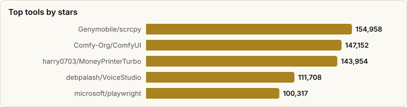
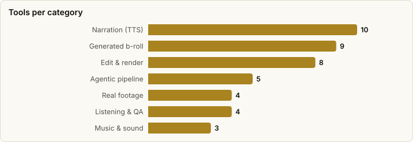

# How the Best Videos Are Made — The Open Video-Creation Stack

> Derived from **kaiser-data**'s 2,896 starred repos (snapshot `2026-11-16T14:38:50.632Z`), cross-referenced with the repo-similarity graph (2,896 nodes / 9,609 edges, 48 communities). Model choices are backed by Hugging Face adoption numbers and licences, and the craft rules by measurements from our own promo films — see Methodology.
>
> Generated 2026-11-18 by `scripts/reports/video_creation.py` (regenerate any time — no API cost).

## Executive summary

- **43 video-making tools** in your stars (**1,605,890★** combined), arranged along the way a film is made:
  - **Real footage** (4): `scrcpy`, `playwright`, `gitlogue`, `reelbird`
  - **Generated b-roll** (9): `ComfyUI`, `diffusers`, `Wan2.2`, `WanGP`, `LTX-2`, `seedance-2.0`, `FastVideo`, `LightX2V`, `LTX-Desktop`
  - **Narration (TTS)** (10): `VoiceStudio`, `voicebox`, `VibeVoice`, `VoxCPM`, `fish-speech`, `chatterbox`, `index-tts`, `F5-TTS`, `Qwen3-TTS`, `pocket-tts`
  - **Music & sound** (3): `ACE-Step-1.5`, `heartlib`, `openverse`
  - **Listening & QA** (4): `faster-whisper`, `whisperX`, `claude-video`, `earshot`
  - **Edit & render** (8): `OpenCut`, `hyperframes`, `anime`, `remotion`, `manim`, `motion`, `filmcraft`, `Math-To-Manim`
  - **Agentic pipeline** (5): `MoneyPrinterTurbo`, `ViMax`, `openshorts`, `dramaclaw`, `herk-edit-kit`
- **A good video is mostly not generated.** The best results here came from real screen footage of the product, a calm voice, music written to the finished cut and a mix checked on a phone. Generated video only adds mood between the true parts.
- **Every stage now has a strong open option you can run yourself**: `LTX-2` and `Wan2.2` for b-roll, `VoxCPM` and `Qwen3-TTS` for the voice, `ACE-Step-1.5` for the score, `remotion` for the edit.
- **New this month: tools that listen.** `earshot` gives an agent ears: it can tell whether the music's beat matches the cuts and whether the mix will hold up. Until now only a person could check that.
- **Licences matter more than benchmarks.** Several of the strongest models cannot go in a commercial film: `F5-TTS` and `fish-speech` weights are non-commercial, and MiniMax H3 excludes the EU entirely. Read the licence on the model card before the first render.
- **GitHub health under-rates model repos.** `Wan2.2`, `Qwen3-TTS` and `chatterbox` read *Declining* below because a model repo goes quiet once the weights ship, yet their weights are downloaded millions of times a month. Judge models on the Hugging Face table.

## How a film is made — and which tool does each step

| Step | What happens | Tools in your stars |
|---|---|---|
| **1. Script** | 6–9 calm lines, one idea per scene, 60–75 s | a person (and `OpenMontage`, `dramaclaw` for drafts) |
| **2. Real footage** | Record the product doing the thing the line says | `playwright`, `reelbird`, `gitlogue`, `scrcpy` |
| **3. Voice** | Cast 2–3 voices on two lines, then render every line | `VoxCPM`, `Qwen3-TTS`, `VibeVoice`, `chatterbox` |
| **4. B-roll** | Mood shots between the true parts | `LTX-2`, `Wan2.2`, `WanGP`, `LightX2V`, `FastVideo`, `ComfyUI` |
| **5. Edit** | Titles, counters, cuts, captions in code | `remotion`, `hyperframes`, `manim`, `motion` |
| **6. Score** | Music written to the locked cut, scenes on whole bars | `ACE-Step-1.5`, `heartlib`, `openverse` |
| **7. Sound effects** | Soft accents where the picture changes | `earshot` (sfx, kits), `openverse` |
| **8. Listen & check** | Beat fit, mix, phone band, names read right | `earshot`, `faster-whisper`, `whisperX`, `claude-video` |
| **9. Deliver** | 16:9 master + 4:5 feed cut with burned-in captions | `remotion` render |

## Eight rules from our own films

Each rule below came from a cut that didn't work. The numbers are measured, not estimated.

1. **Never let AI draw the product.** Product UI, numbers and charts come from a real screen recording. Generated video is only for mood: sky, light, objects. A generated 'UI' is a fabricated feature.
2. **Every narrated claim is true on screen.** Run every live feature you show before locking the script. If the output is wrong, change the shot or the line, never the truth.
3. **Write for someone who has never heard of it.** Name the 3–4 words the film can't avoid and give each an everyday picture: 'a star is a public vote of trust'.
4. **A calm voice, not an advert.** Exclamation marks and short imperatives make TTS shout. Full, gentle sentences read as a storyteller. Offer 2–3 voices and let the ear decide.
5. **Score to the locked cut.** Music written before the edit is final never fits. Make every scene a whole number of bars and give the score an arc and a real ending.
6. **Mix for a phone in a noisy room.** Phone speakers drop everything under ~200 Hz. EQ the music around the voice, duck it under speech and master to −14 LUFS. On the Astrolab promo the phone-band loudness rose from −17.4 to −14.6 LUFS.
7. **Let a machine listen first, then a person.** earshot measures whether cuts land on the beat and whether the genre drifts; Whisper catches a misread product name. Then a person listens around every cut.
8. **Label what is synthetic.** End card: which voice and which shots are AI-generated, and that the app footage is a real recording (EU AI Act Art. 50).

## Master comparison

Sorted by stars. `Health`/`Lifecycle` are the dataset's computed metrics; `Activity` is derived from days-since-push + 90-day commits. For model repos, read the Hugging Face table further down instead.

| Tool | Category | Lang | License | ★ Stars | Lifecycle | Health | Activity | Last push | Age | Contrib(90d) |
|---|---|---|---|---|---|---|---|---|---|---|
| [Genymobile/scrcpy](https://github.com/Genymobile/scrcpy) | Real footage | C | Apache-2.0 | 154,958 (▲558) | Classic | 67 | very active | 2d ago | 9.0y | 11 |
| [Comfy-Org/ComfyUI](https://github.com/Comfy-Org/ComfyUI) | Generated b-roll | Python | GPL-3.0 | 147,152 (▲1,230) | Classic | 80 | very active | 0d ago | 3.8y | 15 |
| [harry0703/MoneyPrinterTurbo](https://github.com/harry0703/MoneyPrinterTurbo) | Agentic pipeline | Python | MIT | 143,954 (▲2,550) | Mature | 90 | very active | 0d ago | 2.7y | 31 |
| [debpalash/VoiceStudio](https://github.com/debpalash/VoiceStudio) | Narration (TTS) | Python | AGPL-3.0 | 111,708 (▲6,020) | Hot | 80 | very active | 0d ago | 7mo | 4 |
| [microsoft/playwright](https://github.com/microsoft/playwright) | Real footage | TypeScript | Apache-2.0 | 100,317 (▲649) | Classic | 85 | very active | 1d ago | 7.0y | 6 |
| [OpenCut-app/OpenCut](https://github.com/OpenCut-app/OpenCut) | Edit & render | TypeScript | MIT | 98,637 (▲741) | Declining | 43 | active | 1mo ago | 1.4y | 1 |
| [heygen-com/hyperframes](https://github.com/heygen-com/hyperframes) | Edit & render | TypeScript | Apache-2.0 | 85,034 (▲3,589) | Hot | 83 | very active | 0d ago | 8mo | 6 |
| [juliangarnier/anime](https://github.com/juliangarnier/anime) | Edit & render | JavaScript | MIT | 74,803 (▲344) | Mature | 53 | active | 14d ago | 10.7y | 0 |
| [remotion-dev/remotion](https://github.com/remotion-dev/remotion) | Edit & render | TypeScript | NOASSERTION | 73,602 (▲1,690) | Classic | 80 | very active | 0d ago | 6.4y | 12 |
| [jamiepine/voicebox](https://github.com/jamiepine/voicebox) | Narration (TTS) | Python | MIT | 60,748 (▲509) | Hot | 71 | active | 1mo ago | 9mo | 15 |
| [microsoft/VibeVoice](https://github.com/microsoft/VibeVoice) | Narration (TTS) | Python | MIT | 57,207 (▲349) | Mature | 47 | active | 1mo ago | 1.2y | 2 |
| [ManimCommunity/manim](https://github.com/ManimCommunity/manim) | Edit & render | Python | MIT | 42,605 (▲242) | Classic | 84 | very active | 2d ago | 6.5y | 28 |
| [OpenBMB/VoxCPM](https://github.com/OpenBMB/VoxCPM) | Narration (TTS) | Python | Apache-2.0 | 42,545 (▲498) | Mature | 61 | active | 7d ago | 1.2y | 5 |
| [motiondivision/motion](https://github.com/motiondivision/motion) | Edit & render | TypeScript | MIT | 35,253 (▲234) | Classic | 65 | very active | 0d ago | 8.0y | 2 |
| [huggingface/diffusers](https://github.com/huggingface/diffusers) | Generated b-roll | Python | Apache-2.0 | 34,923 (▲34) | Classic | 93 | very active | 0d ago | 4.5y | 44 |
| [fishaudio/fish-speech](https://github.com/fishaudio/fish-speech) | Narration (TTS) | Python | NOASSERTION | 33,752 (▲115) | Classic | 73 | active | 2d ago | 3.1y | 11 |
| [resemble-ai/chatterbox](https://github.com/resemble-ai/chatterbox) | Narration (TTS) | Python | MIT | 27,864 (▲161) | Declining | 37 | active | 12d ago | 1.6y | 1 |
| [SYSTRAN/faster-whisper](https://github.com/SYSTRAN/faster-whisper) | Listening & QA | Python | MIT | 26,795 (▲178) | Classic | 59 | active | 4d ago | 3.8y | 10 |
| [m-bain/whisperX](https://github.com/m-bain/whisperX) | Listening & QA | Python | BSD-2-Clause | 25,372 (▲205) | Classic | 72 | active | 4d ago | 3.9y | 4 |
| [index-tts/index-tts](https://github.com/index-tts/index-tts) | Narration (TTS) | Python | NOASSERTION | 25,124 (▲119) | Mature | 50 | active | 1mo ago | 1.8y | 6 |
| [bradautomates/claude-video](https://github.com/bradautomates/claude-video) | Listening & QA | Python | MIT | 20,976 (▲660) | Rising | 59 | active | 1mo ago | 6mo | 1 |
| [Wan-Video/Wan2.2](https://github.com/Wan-Video/Wan2.2) | Generated b-roll | Python | Apache-2.0 | 18,695 (▲209) | Declining | 35 | active | 1mo ago | 1.3y | 2 |
| [storytold/filmcraft](https://github.com/storytold/filmcraft) | Edit & render | Rust | Apache-2.0 | 18,390 (▲507) | Hot | 74 | very active | 0d ago | 1mo | 3 |
| [SWivid/F5-TTS](https://github.com/SWivid/F5-TTS) | Narration (TTS) | Python | MIT | 15,603 (▲63) | Mature | 70 | active | 13d ago | 2.1y | 3 |
| [ace-step/ACE-Step-1.5](https://github.com/ace-step/ACE-Step-1.5) | Music & sound | Python | MIT | 14,846 (▲289) | Mature | 76 | active | 8d ago | 1.2y | 8 |
| [QwenLM/Qwen3-TTS](https://github.com/QwenLM/Qwen3-TTS) | Narration (TTS) | Python | Apache-2.0 | 14,450 (▲139) | Declining | 19 | stale | 8mo ago | 9mo | 0 |
| [HKUDS/ViMax](https://github.com/HKUDS/ViMax) | Agentic pipeline | Python | MIT | 12,936 (▲58) | Declining | 39 | active | 1mo ago | 1.6y | 1 |
| [deepbeepmeep/WanGP](https://github.com/deepbeepmeep/WanGP) | Generated b-roll | Python | NOASSERTION | 11,913 (▲376) | Hot | 74 | very active | 4d ago | 1.7y | 4 |
| [kyutai-labs/pocket-tts](https://github.com/kyutai-labs/pocket-tts) | Narration (TTS) | Python | MIT | 10,315 (▲71) | Hot | 76 | very active | 3d ago | 10mo | 28 |
| [Lightricks/LTX-2](https://github.com/Lightricks/LTX-2) | Generated b-roll | Python | Apache-2.0 | 10,267 (▲108) | Rising | 67 | active | 4d ago | 10mo | 3 |
| [mutonby/openshorts](https://github.com/mutonby/openshorts) | Agentic pipeline | Python | MIT | 8,599 (▲1,011) | Hot | 62 | very active | 0d ago | 11mo | 3 |
| [Emily2040/seedance-2.0](https://github.com/Emily2040/seedance-2.0) | Generated b-roll | Python | MIT | 8,202 (▲95) | Rising | 58 | active | 1mo ago | 8mo | 1 |
| [dramaclaw/dramaclaw](https://github.com/dramaclaw/dramaclaw) | Agentic pipeline | TypeScript | NOASSERTION | 7,728 (▲144) | Hot | 78 | very active | 0d ago | 7mo | 12 |
| [unhappychoice/gitlogue](https://github.com/unhappychoice/gitlogue) | Real footage | Rust | ISC | 5,273 (▲12) | Hot | 75 | very active | 1d ago | 1.0y | 3 |
| [Leonxlnx/earshot](https://github.com/Leonxlnx/earshot) | Listening & QA | Python | MIT | 4,968 (▲640) | Hot | 65 | very active | 0d ago | 1mo | 5 |
| [hao-ai-lab/FastVideo](https://github.com/hao-ai-lab/FastVideo) | Generated b-roll | Python | Apache-2.0 | 4,820 (▲21) | Mature | 73 | very active | 1d ago | 2.1y | 28 |
| [HeartMuLa/heartlib](https://github.com/HeartMuLa/heartlib) | Music & sound | Python | Apache-2.0 | 3,799 (▲10) | Rising | 48 | very active | 1d ago | 10mo | 4 |
| [ModelTC/LightX2V](https://github.com/ModelTC/LightX2V) | Generated b-roll | Python | Apache-2.0 | 3,009 (▲13) | Hot | 69 | very active | 0d ago | 1.6y | 16 |
| [nateherkai/herk-edit-kit](https://github.com/nateherkai/herk-edit-kit) | Agentic pipeline | HTML | NOASSERTION | 2,880 (▲204) | Rising | 41 | active | 1mo ago | 7mo | 1 |
| [HarleyCoops/Math-To-Manim](https://github.com/HarleyCoops/Math-To-Manim) | Edit & render | Python | MIT | 2,879 (▲33) | Hot | 73 | very active | 1d ago | 1.8y | 5 |
| [Lightricks/LTX-Desktop](https://github.com/Lightricks/LTX-Desktop) | Generated b-roll | Python | Apache-2.0 | 2,280 (▲45) | Rising | 66 | very active | 5d ago | 8mo | 3 |
| [WordPress/openverse](https://github.com/WordPress/openverse) | Music & sound | Python | MIT | 660 (▲89) | Classic | 77 | very active | 0d ago | 5.6y | 6 |
| [btahir/reelbird](https://github.com/btahir/reelbird) | Real footage | Swift | MIT | 49 (▲1) | Rising | 75 | very active | 1d ago | 1mo | 1 |

## Task rankings — which tool for which job

Ranked picks per task. Dataset metrics say who is *maintained*; Hugging Face adoption, licences and our own measured runs say who is *worth using* (evidence per row, sources in Methodology).

| Task | 🥇 First pick | 🥈 Second | 🥉 Third | Evidence / note |
|---|---|---|---|---|
| **Product footage (the part that must be true)** | `playwright` — scripted, repeatable, sharp UI text | `reelbird` — fastest honest screen demo on a Mac | `gitlogue` — terminal/repo projects with no UI | Rule: AI never draws the product. CDP screencast at JPEG q95 → 30 fps stayed readable where record_video blurred text. |
| **Mood b-roll, self-hosted, usable in the EU** | `LTX-2` — LTX-2.5: ♥10.5k, 2.49M downloads/30 d, native 1080p + audio | `Wan2.2` — Apache-2.0; Comfy-Org/Wan-2.2 9.5M downloads/30 d | `WanGP` — one runner for both on a consumer GPU | LTX-2.x licence is free under $10M revenue. MiniMax H3 leads on downloads but excludes the EU/UK/US/KR. |
| **Extra takes fast (iterate on a shot)** | `LightX2V` — 4-step Lightning LoRA: ~85 s vs ~25 min per Wan shot (H200, measured) | `FastVideo` — sparse attention + distilled checkpoints | `WanGP` — low-VRAM profiles for every model | Fast takes look busier and more stylised — they add options, not a free upgrade. |
| **Calm narrator for a commercial film** | `VoxCPM` — VoxCPM2 Apache-2.0, 965k downloads/30 d; best hushed storyteller | `Qwen3-TTS` — Apache-2.0, 3.45M downloads/30 d; cloned takes stayed within 2 LU | `chatterbox` — MIT, 2.24M downloads/30 d; warm alternative | Licence decides first: F5-TTS (CC-BY-NC) and fish-speech (CC-BY-NC-SA) are non-commercial. |
| **Narration without cloning or a GPU** | `VibeVoice` — MIT Realtime-0.5B, preset voices, streams | `pocket-tts` — runs on a CPU | `mlx-audio` — Apple Silicon | Good for scratch narration while the cut is still moving; cast the final voice later. |
| **A score that fits the picture** | `ACE-Step-1.5` — MIT; 4 takes of ~80 s in ~2 min on an L40S (measured) | `heartlib` — Apache-2.0 alternative, strongest open rival in ACE-Step's paper | `openverse` — licensed human-made tracks when generation won't do | Score after picture lock, whole bars per scene, generate exact length + 2 bars — never time-stretch. |
| **Sound effects on the cuts** | `earshot` — renders whooshes, pops and ticks in code, aimed at a frame; no licence questions | `openverse` — CC0/CC-BY effects with attribution data | `LTX-2` — generates synced ambience with the shot (audio-video model) | Crossfades hide cuts; a soft accent under the voice, out of 1–4 kHz, makes them land. |
| **Checking the sound before anyone hears it** | `earshot` — beat clarity, % of cuts on an onset, genre drift, mix critique | `faster-whisper` — WER + exact product-name check per take | `claude-video` — frames + transcript of the finished render | On one promo, earshot's `critique` scored the mix 22/22 while `timeline` showed only 38 % of cuts on the beat — the music did not fit. |
| **Edit and render in code** | `remotion` — React scenes, exact frames, headless render | `hyperframes` — HTML-to-video, agent-friendly | `manim` — diagrams and math explainers | Code edits are re-runnable: a script change re-renders both formats (16:9 + 4:5) in minutes. |
| **Topic to finished short in one go** | `OpenMontage` — most complete agentic pipeline | `MoneyPrinterTurbo` — simplest: topic → short with subtitles | `dramaclaw` — story-driven ads and dramas | Fast drafts; nobody checks that the claims on screen are true — keep a human truth pass. |
| **Turning long videos into shorts** | `openshorts` — AI moment detection → 9:16 clips | `herk-edit-kit` — agent-driven reels from Claude Code | `OpenCut` — manual polish on the timeline | Feeds play muted: burn in captions and put one claim per scene on screen. |

## The models behind the repos (Hugging Face, 2026-11-04)

A model's GitHub repo goes quiet once the weights ship, so commit-based health calls good models *Declining*. Downloads and hearts on Hugging Face show what people actually run; the licence decides whether you may use it.

| Model | ♥ Hearts | Downloads (30 d) | Licence | Commercial film in the EU? |
|---|---|---|---|---|
| [Lightricks/LTX-2.5](https://huggingface.co/Lightricks/LTX-2.5) | 10,495 | 2,488,128 | LTX-2.x community (free < $10M revenue, gated) | Yes |
| [Comfy-Org/Wan-2.2](https://huggingface.co/Comfy-Org/Wan-2.2) | 995 | 9,489,939 | Apache-2.0 | Yes |
| [MiniMaxAI/MiniMax-H3](https://huggingface.co/MiniMaxAI/MiniMax-H3) | 6,548 | 6,335,317 | MiniMax H3 community (excludes EU/UK/US/KR) | **No** |
| [openbmb/VoxCPM2](https://huggingface.co/openbmb/VoxCPM2) | 1,750 | 965,306 | Apache-2.0 | Yes |
| [Qwen/Qwen3-TTS-12Hz-1.7B-Base](https://huggingface.co/Qwen/Qwen3-TTS-12Hz-1.7B-Base) | 586 | 3,453,075 | Apache-2.0 | Yes |
| [ResembleAI/chatterbox](https://huggingface.co/ResembleAI/chatterbox) | 1,887 | 2,239,938 | MIT | Yes |
| [microsoft/VibeVoice-Realtime-0.5B](https://huggingface.co/microsoft/VibeVoice-Realtime-0.5B) | 1,309 | 233,005 | MIT | Yes |
| [SWivid/F5-TTS](https://huggingface.co/SWivid/F5-TTS) | 1,226 | 1,275,416 | CC-BY-NC-4.0 | **No** (non-commercial) |
| [fishaudio/openaudio-s1-mini](https://huggingface.co/fishaudio/openaudio-s1-mini) | 789 | 2,160 | CC-BY-NC-SA-4.0 | **No** (non-commercial) |
| [ACE-Step/Ace-Step1.5](https://huggingface.co/ACE-Step/Ace-Step1.5) | 937 | 93,349 | MIT | Yes |
| [HeartMuLa/HeartMuLa-oss-3B](https://huggingface.co/HeartMuLa/HeartMuLa-oss-3B) | 262 | 775 | Apache-2.0 | Yes |

## By category

### Real footage

_The part of the film that must be true. Record the product doing exactly what the narration says — these tools make that repeatable and sharp._

- **[Genymobile/scrcpy](https://github.com/Genymobile/scrcpy)** · 154,958★ · C · Classic  
  Mirrors and records an Android phone from the desktop — real mobile-app footage.  
  topics: android, c, sdl2, libav, ffmpeg, screen, mirroring, recording
- **[microsoft/playwright](https://github.com/microsoft/playwright)** · 100,317★ · TypeScript · Classic  
  Drives a real browser; its CDP screencast gives crisp 30 fps product footage (its built-in record_video is too soft for UI text).  
  topics: playwright, testing, automation, webkit, firefox, e2e-testing, web, chrome
- **[unhappychoice/gitlogue](https://github.com/unhappychoice/gitlogue)** · 5,273★ · Rust · Hot  
  Replays a Git history as a cinematic terminal scene — footage for projects that have no UI.  
  topics: cli-tool, code-animation, developer-tools, git, git-history, git-visualization, productivity, ratatui
- **[btahir/reelbird](https://github.com/btahir/reelbird)** · 49★ · Swift · Rising  
  Free macOS screen recorder with auto-zoom and an instant share link — the quickest honest demo.  
  topics: auto-zoom, captions, cloudflare-r2, loom-alternative, macos, macos-app, mcp, mcp-server

### Generated b-roll

_Open video models and the runners around them. Use them for mood (light, sky, objects), never for the product itself._

- **[Comfy-Org/ComfyUI](https://github.com/Comfy-Org/ComfyUI)** · 147,152★ · Python · Classic  
  Node-graph GUI and backend for diffusion models — where most open video workflows are shared.  
  topics: stable-diffusion, pytorch, ai, python, comfy, comfyui
- **[huggingface/diffusers](https://github.com/huggingface/diffusers)** · 34,923★ · Python · Classic  
  The PyTorch library most open video/image/audio diffusion models ship through.  
  topics: deep-learning, diffusion, image-generation, pytorch, score-based-generative-modeling, image2image, text2image, stable-diffusion
- **[Wan-Video/Wan2.2](https://github.com/Wan-Video/Wan2.2)** · 18,695★ · Python · Declining  
  Alibaba's Apache-2.0 video models (T2V/I2V/TI2V); quiet on GitHub, still heavily used through ComfyUI.  
  topics: aigc, video-generation
- **[deepbeepmeep/WanGP](https://github.com/deepbeepmeep/WanGP)** · 11,913★ · Python · Hot  
  'Video generator for the GPU poor' — one runner for Wan, LTX-2.x, MiniMax H3, Hunyuan and more on consumer cards.  
  topics: ai, flux, generative-ai, hunyuan-video, ltx-video, video, wan, flux2
- **[Lightricks/LTX-2](https://github.com/Lightricks/LTX-2)** · 10,267★ · Python · Rising  
  Inference + LoRA trainer for the LTX-2.x audio-video models; LTX-2.5 is the most-downloaded open video model on Hugging Face.  
  topics: generative-ai, ltx, ltx-2
- **[Emily2040/seedance-2.0](https://github.com/Emily2040/seedance-2.0)** · 8,202★ · Python · Rising  
  A prompt-and-shot production pipeline for Seedance 2.0 (a paid, closed model) — useful as a shot-writing method.  
  topics: —
- **[hao-ai-lab/FastVideo](https://github.com/hao-ai-lab/FastVideo)** · 4,820★ · Python · Mature  
  Unified inference + post-training framework for accelerated (sparse-attention, distilled) video generation.  
  topics: diffusers, diffusion-models, video-generation, distillation, inference, post-training
- **[ModelTC/LightX2V](https://github.com/ModelTC/LightX2V)** · 3,009★ · Python · Hot  
  Lightweight inference framework; its 4-step Lightning LoRAs turn a 25-minute Wan shot into ~85 s.  
  topics: video-generation, wan-video, diffusion-models, auto-regressive-diffusion-model, world-models, qwen-image, ltx-video, hunyuan-video
- **[Lightricks/LTX-Desktop](https://github.com/Lightricks/LTX-Desktop)** · 2,280★ · Python · Rising  
  Desktop app for LTX models — generate shots locally without writing code.  
  topics: generative-ai, ltx, ltx-2, non-linear-editing

### Narration (TTS)

_Open voices. Pick by licence first, then by ear: cast two lines in several voices before rendering the script._

- **[debpalash/VoiceStudio](https://github.com/debpalash/VoiceStudio)** · 111,708★ · Python · Hot  
  Fully local ElevenLabs-style studio (cloning, voice design); AGPL-3.0.  
  topics: tts, voice-cloning, voice-generation, voice-ai, ai, cuda, mlx, huggingface
- **[jamiepine/voicebox](https://github.com/jamiepine/voicebox)** · 60,748★ · Python · Hot  
  Open voice studio app: clone, dictate, create — a GUI around open TTS models.  
  topics: ai, voice-clone, qwen3-tts, voice-ai, whisper, qwen3-tts-ui, cuda, mlx
- **[microsoft/VibeVoice](https://github.com/microsoft/VibeVoice)** · 57,207★ · Python · Mature  
  Microsoft's open voice models (MIT); long-form TTS was withdrawn, Realtime-0.5B with preset voices remains.  
  topics: —
- **[OpenBMB/VoxCPM](https://github.com/OpenBMB/VoxCPM)** · 42,545★ · Python · Mature  
  VoxCPM2: tokenizer-free multilingual TTS with voice design and cloning; Apache-2.0. Our calm-documentary default.  
  topics: audio, deeplearning, minicpm, python, pytorch, speech, speech-synthesis, text-to-speech
- **[fishaudio/fish-speech](https://github.com/fishaudio/fish-speech)** · 33,752★ · Python · Classic  
  Strong expressive TTS; weights are CC-BY-NC-SA — research and personal films only.  
  topics: llama, transformer, tts, valle, vits, vqgan, vqvae
- **[resemble-ai/chatterbox](https://github.com/resemble-ai/chatterbox)** · 27,864★ · Python · Declining  
  MIT TTS with an emotion/exaggeration knob — a warm alternative take.  
  topics: —
- **[index-tts/index-tts](https://github.com/index-tts/index-tts)** · 25,124★ · Python · Mature  
  Industrial zero-shot TTS with duration control — useful when a line must fit an exact scene length.  
  topics: bigvgan, cross-lingual, indextts, text-to-speech, tts, voice-clone, zero-shot-tts
- **[SWivid/F5-TTS](https://github.com/SWivid/F5-TTS)** · 15,603★ · Python · Mature  
  Flow-matching TTS with fast zero-shot cloning; weights CC-BY-NC — not for commercial promos.  
  topics: —
- **[QwenLM/Qwen3-TTS](https://github.com/QwenLM/Qwen3-TTS)** · 14,450★ · Python · Declining  
  Apache-2.0 TTS with VoiceDesign (describe a voice in words) and Base cloning; the steadiest loudness across takes we measured.  
  topics: —
- **[kyutai-labs/pocket-tts](https://github.com/kyutai-labs/pocket-tts)** · 10,315★ · Python · Hot  
  Small TTS that runs on a CPU — drafts and scratch narration without a GPU.  
  topics: —

### Music & sound

_The score and the sound around the voice — generated to the cut, or found with a licence attached._

- **[ace-step/ACE-Step-1.5](https://github.com/ace-step/ACE-Step-1.5)** · 14,846★ · Python · Mature  
  MIT music model: a full instrumental take in seconds; section tags in the lyrics field shape the arc. Our score engine.  
  topics: text2music
- **[HeartMuLa/heartlib](https://github.com/HeartMuLa/heartlib)** · 3,799★ · Python · Rising  
  Apache-2.0 music-generation family (model, codec, lyric transcriber) — the main open rival in ACE-Step's own benchmark.  
  topics: ai-music, audio-codec, cover-song, music-ai, music-generation, music-remix, pytorch, text-to-music
- **[WordPress/openverse](https://github.com/WordPress/openverse)** · 660★ · Python · Classic  
  Search engine for openly licensed images and audio (CC0/CC-BY) — music and effects with a licence trail.  
  topics: openverse, creative-commons, search-engine, python, javascript, hacktoberfest, typescript

### Listening & QA

_Tools that hear and read the result, so problems are caught before a person has to listen to every take._

- **[SYSTRAN/faster-whisper](https://github.com/SYSTRAN/faster-whisper)** · 26,795★ · Python · Classic  
  Fast Whisper transcription — the WER and product-name check on every narration take.  
  topics: deep-learning, inference, quantization, speech-recognition, speech-to-text, transformer, whisper, openai
- **[m-bain/whisperX](https://github.com/m-bain/whisperX)** · 25,372★ · Python · Classic  
  Whisper with word-level timestamps — exact caption timing and line lengths.  
  topics: asr, speech, speech-recognition, speech-to-text, whisper
- **[bradautomates/claude-video](https://github.com/bradautomates/claude-video)** · 20,976★ · Python · Rising  
  Lets Claude 'watch' a video: frames + transcript — a second pair of eyes on a render.  
  topics: —
- **[Leonxlnx/earshot](https://github.com/Leonxlnx/earshot)** · 4,968★ · Python · Hot  
  'Ears for coding agents': describes audio in words, checks whether music cuts land on the beat, critiques a mix, and renders sound effects in code.  
  topics: ai-agents, audio, claude-code, mcp, sound-design

### Edit & render

_Where the film is assembled. Code-based editors make every change re-runnable in both formats._

- **[OpenCut-app/OpenCut](https://github.com/OpenCut-app/OpenCut)** · 98,637★ · TypeScript · Declining  
  The open-source CapCut alternative — quick manual edits.  
  topics: editor, oss, videoeditor
- **[heygen-com/hyperframes](https://github.com/heygen-com/hyperframes)** · 85,034★ · TypeScript · Hot  
  Write HTML, render video — a composition format built for agents.  
  topics: ai, animation, ffmpeg, framework, gsap, html, mcp, puppeteer
- **[juliangarnier/anime](https://github.com/juliangarnier/anime)** · 74,803★ · JavaScript · Mature  
  Light JS animation engine for SVG/DOM — logo and title motion.  
  topics: animation, anime, javascript-library, svg, canvas, css, javascript
- **[remotion-dev/remotion](https://github.com/remotion-dev/remotion)** · 73,602★ · TypeScript · Classic  
  Videos as React components: titles, counters and cuts in code, rendered headless (on Modal for us).  
  topics: react, video, javascript
- **[ManimCommunity/manim](https://github.com/ManimCommunity/manim)** · 42,605★ · Python · Classic  
  Precise animated diagrams and math — the explainer engine.  
  topics: math, python, manim, animations, hacktoberfest
- **[motiondivision/motion](https://github.com/motiondivision/motion)** · 35,253★ · TypeScript · Classic  
  React/JS animation library — the motion inside a coded scene.  
  topics: animation, animation-js, motion, react, reactanimations, spring
- **[storytold/filmcraft](https://github.com/storytold/filmcraft)** · 18,390★ · Rust · Hot  
  Open non-linear video editor written in Rust — a timeline when you want hands-on cutting.  
  topics: art, rust, video, video-editing, video-editor, video-processing
- **[HarleyCoops/Math-To-Manim](https://github.com/HarleyCoops/Math-To-Manim)** · 2,879★ · Python · Hot  
  Turns a prompt or image into manim scenes and study notes.  
  topics: —

### Agentic pipeline

_Brief-to-film systems. Fast for drafts and shorts; none of them checks that what the film claims is true._

- **[harry0703/MoneyPrinterTurbo](https://github.com/harry0703/MoneyPrinterTurbo)** · 143,954★ · Python · Mature  
  Topic or keyword → short video with stock footage, TTS and subtitles in one click.  
  topics: python, tiktok, ai-video-generator, content-creation, ffmpeg, instagram-reels, llm, short-video
- **[HKUDS/ViMax](https://github.com/HKUDS/ViMax)** · 12,936★ · Python · Declining  
  Director, screenwriter and producer agents around a video generator.  
  topics: agentic-aigc, video-generation
- **[mutonby/openshorts](https://github.com/mutonby/openshorts)** · 8,599★ · Python · Hot  
  Finds the strongest moments in a long video and cuts 9:16 shorts.  
  topics: clip-generator, open-source, shorts, tiktok, ugc-platform, video-editing, video-generation, ai-clip-generator
- **[dramaclaw/dramaclaw](https://github.com/dramaclaw/dramaclaw)** · 7,728★ · TypeScript · Hot  
  Script-to-film engine for dramas, ads and explainers.  
  topics: ai-agent, ai-filmmaking, ai-video, aigc, content-creation, fastapi, generative-ai, image-to-video
- **[nateherkai/herk-edit-kit](https://github.com/nateherkai/herk-edit-kit)** · 2,880★ · HTML · Rising  
  Edit reels and YouTube Shorts from Claude Code or Codex.  
  topics: claude-code, codex, hyperframes, motion-graphics, reels, video-editing, herk-edit-kit, nate-herk

## Spotlight: giving the agent ears

Until recently an agent making a film could check the picture (screenshots, contact sheets) but not the sound: whether the music fits, whether a cut lands on the beat, whether the voice still reads on a phone. `earshot` (MIT, CPU-only) closes that gap:

- **`earshot timeline film.mp4 --cues …`** — beat clarity, which share of scene cuts land on a musical onset, and the genre of each section. On one promo it showed beat clarity 0.18 and 38 % of cuts on the grid, with the style drifting into house and vocal chops: exactly what the listener had complained about.
- **`earshot critique`** is a mastering gate, not a fit test: the same promo scored 22/22 there. Use both.
- **`earshot kit` / `sfx render`** draws soft pops, ticks and whooshes in code, aimed at a frame, so every cut can get its own small accent with no sample licences.
- Paired with **`ACE-Step-1.5`** (score written to the cue sheet) and **Whisper** (narration check), the whole soundtrack can be checked by numbers before a person listens around the cuts.

## Graph analysis — how they relate

**Community clustering.** These 43 tools span **19 of the graph's 48 communities** — video making borrows from many neighbourhoods of the collection.

- **Community 27** (5): `ModelTC/LightX2V`, `fishaudio/fish-speech`, `SWivid/F5-TTS`, `SYSTRAN/faster-whisper`, `m-bain/whisperX`
- **Community 21** (4): `microsoft/playwright`, `microsoft/VibeVoice`, `WordPress/openverse`, `OpenCut-app/OpenCut`
- **Community 35** (4): `Lightricks/LTX-2`, `Lightricks/LTX-Desktop`, `deepbeepmeep/WanGP`, `dramaclaw/dramaclaw`
- **Community 17** (4): `Wan-Video/Wan2.2`, `hao-ai-lab/FastVideo`, `kyutai-labs/pocket-tts`, `HKUDS/ViMax`
- **Community 12** (4): `jamiepine/voicebox`, `debpalash/VoiceStudio`, `remotion-dev/remotion`, `juliangarnier/anime`
- **Community 5** (3): `btahir/reelbird`, `HarleyCoops/Math-To-Manim`, `motiondivision/motion`
- **Community 25** (3): `Comfy-Org/ComfyUI`, `OpenBMB/VoxCPM`, `index-tts/index-tts`
- **Community 13** (3): `resemble-ai/chatterbox`, `ace-step/ACE-Step-1.5`, `bradautomates/claude-video`
- **Community 11** (2): `Leonxlnx/earshot`, `nateherkai/herk-edit-kit`
- **Community 20** (2): `harry0703/MoneyPrinterTurbo`, `mutonby/openshorts`

**Centrality (PageRank in the full 2,896-repo graph)** — the most connected video tools in your collection:

- `m-bain/whisperX` — PageRank 0.0010
- `motiondivision/motion` — PageRank 0.0007
- `storytold/filmcraft` — PageRank 0.0007
- `remotion-dev/remotion` — PageRank 0.0007
- `Leonxlnx/earshot` — PageRank 0.0006
- `microsoft/playwright` — PageRank 0.0005
- `HKUDS/ViMax` — PageRank 0.0005
- `HarleyCoops/Math-To-Manim` — PageRank 0.0005
- `nateherkai/herk-edit-kit` — PageRank 0.0005
- `Lightricks/LTX-2` — PageRank 0.0004

**Direct links between video tools** (top similarity edges where both endpoints are in this report):

- `Lightricks/LTX-Desktop` ⇄ `Lightricks/LTX-2` (w=1.300) — topics: generative-ai, ltx, ltx-2
- `SWivid/F5-TTS` ⇄ `m-bain/whisperX` (w=0.383) — authors: li-lizhe
- `HKUDS/ViMax` ⇄ `Wan-Video/Wan2.2` (w=0.383) — topics: video-generation
- `m-bain/whisperX` ⇄ `SYSTRAN/faster-whisper` (w=0.350) — topics: speech-recognition, speech-to-text, whisper
- `jamiepine/voicebox` ⇄ `debpalash/VoiceStudio` (w=0.224) — topics: ai, voice-ai, cuda, mlx
- `SWivid/F5-TTS` ⇄ `fishaudio/fish-speech` (w=0.204) — authors: li-lizhe
- `fishaudio/fish-speech` ⇄ `m-bain/whisperX` (w=0.193) — authors: li-lizhe
- `Lightricks/LTX-2` ⇄ `deepbeepmeep/WanGP` (w=0.193) — topics: generative-ai, ltx-2
- `hao-ai-lab/FastVideo` ⇄ `ModelTC/LightX2V` (w=0.193) — topics: diffusion-models, video-generation
- `hao-ai-lab/FastVideo` ⇄ `HKUDS/ViMax` (w=0.193) — topics: video-generation
- `Lightricks/LTX-Desktop` ⇄ `deepbeepmeep/WanGP` (w=0.183) — topics: generative-ai, ltx-2
- `ModelTC/LightX2V` ⇄ `deepbeepmeep/WanGP` (w=0.145) — topics: ltx-video, hunyuan-video
- `mutonby/openshorts` ⇄ `harry0703/MoneyPrinterTurbo` (w=0.113) — topics: tiktok, youtube-shorts
- `fishaudio/fish-speech` ⇄ `kyutai-labs/pocket-tts` (w=0.103) — authors: pratikgx

## Maintenance & risk signal

Bus factor = commit concentration (1 = single-maintainer risk). Pair with lifecycle + activity before adopting a *tool*; for *model* repos see the Hugging Face table.

| Tool | Health | Lifecycle | Activity | Bus factor | Top-author share | Releases |
|---|---|---|---|---|---|---|
| huggingface/diffusers | 93 | Classic | very active | 4 | 24% | 97 |
| harry0703/MoneyPrinterTurbo | 90 | Mature | very active | 3 | 23% | 23 |
| microsoft/playwright | 85 | Classic | very active | 2 | 45% | 170 |
| ManimCommunity/manim | 84 | Classic | very active | 3 | 26% | 36 |
| heygen-com/hyperframes | 83 | Hot | very active | 2 | 46% | 640 |
| Comfy-Org/ComfyUI | 80 | Classic | very active | 2 | 32% | 166 |
| debpalash/VoiceStudio | 80 | Hot | very active | 1 | 82% | 56 |
| remotion-dev/remotion | 80 | Classic | very active | 1 | 51% | 703 |
| dramaclaw/dramaclaw | 78 | Hot | very active | 1 | 55% | 31 |
| WordPress/openverse | 77 | Classic | very active | 1 | 70% | 300 |
| kyutai-labs/pocket-tts | 76 | Hot | very active | 1 | 54% | 16 |
| ace-step/ACE-Step-1.5 | 76 | Mature | active | 3 | 27% | 13 |
| btahir/reelbird | 75 | Rising | very active | 1 | 100% | 11 |
| unhappychoice/gitlogue | 75 | Hot | very active | 1 | 68% | 18 |
| deepbeepmeep/WanGP | 74 | Hot | very active | 1 | 96% | 9 |
| storytold/filmcraft | 74 | Hot | very active | 1 | 94% | 23 |
| hao-ai-lab/FastVideo | 73 | Mature | very active | 2 | 43% | 8 |
| fishaudio/fish-speech | 73 | Classic | active | 4 | 20% | 15 |
| HarleyCoops/Math-To-Manim | 73 | Hot | very active | 1 | 80% | 4 |
| m-bain/whisperX | 72 | Classic | active | 2 | 46% | 44 |
| jamiepine/voicebox | 71 | Hot | active | 1 | 60% | 25 |
| SWivid/F5-TTS | 70 | Mature | active | 2 | 43% | 22 |
| ModelTC/LightX2V | 69 | Hot | very active | 2 | 28% | 3 |
| Genymobile/scrcpy | 67 | Classic | very active | 1 | 79% | 54 |
| Lightricks/LTX-2 | 67 | Rising | active | 1 | 80% | 9 |
| Lightricks/LTX-Desktop | 66 | Rising | very active | 1 | 50% | 15 |
| Leonxlnx/earshot | 65 | Hot | very active | 1 | 82% | 4 |
| motiondivision/motion | 65 | Classic | very active | 1 | 69% | 0 |
| mutonby/openshorts | 62 | Hot | very active | 1 | 61% | 0 |
| OpenBMB/VoxCPM | 61 | Mature | active | 1 | 53% | 14 |
| SYSTRAN/faster-whisper | 59 | Classic | active | 2 | 38% | 21 |
| bradautomates/claude-video | 59 | Rising | active | 1 | 100% | 8 |
| Emily2040/seedance-2.0 | 58 | Rising | active | 1 | 100% | 2 |
| juliangarnier/anime | 53 | Mature | active | 0 | 0% | 37 |
| index-tts/index-tts | 50 | Mature | active | 2 | 25% | 3 |
| HeartMuLa/heartlib | 48 | Rising | very active | 1 | 83% | 0 |
| microsoft/VibeVoice | 47 | Mature | active | 1 | 57% | 0 |
| OpenCut-app/OpenCut | 43 | Declining | active | 1 | 100% | 4 |
| nateherkai/herk-edit-kit | 41 | Rising | active | 1 | 100% | 0 |
| HKUDS/ViMax | 39 | Declining | active | 1 | 100% | 1 |
| resemble-ai/chatterbox | 37 | Declining | active | 1 | 100% | 1 |
| Wan-Video/Wan2.2 | 35 | Declining | active | 1 | 50% | 0 |
| QwenLM/Qwen3-TTS | 19 | Declining | stale | 0 | 0% | 0 |

Watch items: `ViMax` and `OpenCut` read *Declining* as tools (not models) — check recent commits before building on them; `VoiceStudio` and `OpenMontage` are AGPL-3.0, which matters if you ship them inside a product; GitHub detects no standard licence for `herk-edit-kit`, `dramaclaw` or `index-tts` — read their terms before commercial use.

## Adjacent (deliberately not listed as video tools)

- **MiniMax-AI/MiniMax-H3** — not starred, but the most-downloaded open video model of 2026 (6.3M downloads/30 days, native stereo audio, 2K). Its licence **excludes the EU, the UK, the USA and South Korea** — outputs may not even be used there. Out for us
- **Lightricks/LTX-Video** (11,403★) — the first LTX generation, superseded by `LTX-2`
- **lllyasviel/FramePack** (17,358★) — influential long-video trick, unmaintained since 2025
- **NVIDIA/cosmos-framework** (643★) — world-model framework for robotics and physical AI, not film b-roll
- **SamurAIGPT/seedance-2-generator** (105★) — a SaaS shell around a paid reseller API — no model inside
- **SamurAIGPT/muapi-comfyui** (82★) — ComfyUI nodes that call a paid API (muapi.ai), not open weights
- **Anil-matcha/Open-Generative-AI** (34,961★) — front-end for many hosted image/video models
- **duixcom/Duix-Avatar** (16,357★) — talking-head avatars: a generated person presenting is out of scope (and needs clear labelling)
- **Nutlope/hallmark** (55,850★) — anti-AI-slop *design* skill for web UIs — good for the product you film, not for the film
- **yt-dlp/yt-dlp** (208,307★) — downloads other people's videos — fine for study, not as footage without a licence
- **pipecat-ai/pipecat** (17,287★) — real-time voice agents — see the *Voice agents* report

## Methodology & caveats

- **Source**: `data/classified.json` + `public/data/graph.json` for all repo metrics and graph structure. No API calls at generation time; fully reproducible.
- **Selection**: keyword scan (video / tts / voice / music / audio / sound / remotion / animation / diffusion / subtitle) + manual curation into film-making steps. Voice agents, transcription apps, avatars and paid-API wrappers were routed to adjacent reports or excluded (see above).
- **Model evidence**: Hugging Face model API (`likes`, 30-day `downloads`, `trendingScore`, card licence), retrieved 2026-11-04. Licences read from each model card / LICENSE file (MiniMax H3 community licence, LTX-2.x community licence). Public leaderboards (Artificial Analysis, TTS Arena) disagreed across snapshots and rank mostly closed models, so they were not used for the rankings.
- **Craft rules and timings** come from our own productions (Astrolab promo, 2026-11): Modal run logs, ffmpeg `ebur128` loudness measurements and `earshot` reports. ACE-Step 1.5 benchmark claims are vendor-reported ([paper](https://arxiv.org/abs/2602.00744)).
- **Metrics** (health, lifecycle, bus_factor) are precomputed at snapshot time and may lag GitHub's current state. Model numbers and licences are frozen text — re-check them when a major model ships.

Tools covered: 43 · Snapshot: 2026-11-16T14:38:50.632Z
